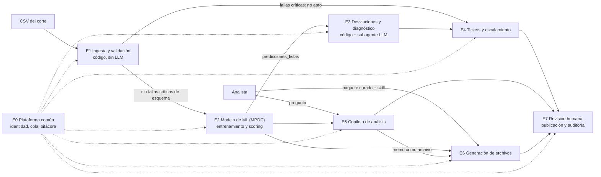

# PRD: Plataforma de IA para Data Science de Banamex — cubo Base Cards

| | |
|---|---|
| **Equipo** | Héctor Lugo Gabino (A01029811) · Efren Chávez Camacho (A01769533) · Diego Vergara Hernández (A01425660) · Santino Matías Im (A01029622) |
| **Profesor** |  |
| **Materia** | Inteligencia artificial avanzada para la ciencia de datos (TC3009C.621) |
| **Fecha de entrega** | 13/11/2026 |
| **Versión** | 1.1 (17/11/2026): formato Markdown; alineado con `Manual_Tecnico_Plataforma_BaseCards.md` v0.3 |
| **Documento técnico** | [`Manual_Tecnico_Plataforma_BaseCards.md`](Manual_Tecnico_Plataforma_BaseCards.md) detalla cómo se construye lo que este PRD pide |


---

## 1. Resumen

El proyecto entrega una plataforma de IA para el área de Data Science de Banamex que valida, analiza, explica y reporta el desempeño de la cartera de tarjetas de crédito a partir del cubo Base Cards. Corre completa en servidores locales con modelos de lenguaje de pesos abiertos: ningún dato sale de la máquina ni del perímetro del banco.

**Para quién.** Analistas de datos, dueños de datos y líderes de riesgo del área de Data Science.

**Cuatro capacidades sobre una plataforma común:**

- **Núcleo de analítica.** El Modelo de Pronóstico de Desempeño por Cohorte (MPDC), un modelo de machine learning clásico, predice la tasa de pérdida neta, la tasa de morosidad y el margen de cada cohorte con un intervalo de predicción (sección 6).
- **Agente de Soporte de Datos.** Valida cada corte del cubo, detecta desviaciones contra el MPDC, diagnostica la causa y abre tickets con evidencia (sección 7.2).
- **Copiloto de análisis.** Responde preguntas de análisis del analista con cifras del cubo y del MPDC, y redacta un memo de riesgo (sección 7.3).
- **Agente Creador de Presentaciones y Documentos.** Convierte paquetes de datos curados por el analista en presentaciones, documentos y hojas de cálculo con plantillas versionadas (skills) y verifica cada cifra (sección 7.4).

**El pipeline.**



Cada corte del cubo pasa por validación determinista (E1), scoring del MPDC (E2), diagnóstico de desviaciones (E3) y tickets (E4). El Copiloto (E5) y el generador de archivos (E6) trabajan bajo demanda, y todo termina en revisión humana y auditoría (E7) (sección 4).

**Dónde corre.** En la computadora del Tec (servidor Linux sin entorno gráfico) con Docker Compose, y en los servidores del banco sin internet con el mismo paquete (sección 9).

**Garantía de privacidad.** Solo se usan modelos de pesos abiertos instalados localmente. No se llama a ninguna API de LLM externa, los agentes no acceden a la base de datos principal del banco y el cubo no contiene datos de clientes (sección 10).

---

## 2. Contexto del proyecto

El proyecto es la propuesta del equipo para el reto del semestre con el socio Banamex, en un equipo de 4 integrantes. La construcción dura 2 semanas (10 días hábiles, sección 16).

**El cubo Base Cards.** Banamex entregó el diccionario de una base agregada por cohorte de adquisición: cosecha (VINTAGE), estrategia, segmento, producto, canal, edad y rango de score, observada mes a mes desde la apertura (MOB, *Month on Book*). Contiene volumen, morosidad (Over30), pérdidas (GCL, NCL y recuperaciones), ingresos y gastos. Cubre cosechas de 202401 a 202609 y no contiene datos personales de clientes. El detalle está en la sección 5.

**Flujo actual del área de Data Science (supuesto):**

1. Se carga un corte mensual del cubo.
2. El analista extrae las vistas que necesita.
3. El analista calcula indicadores, revisa que cuadren y cura las tablas.
4. El analista arma la presentación o el documento ejecutivo.
5. Si algo no cuadra, el analista investiga por su cuenta o levanta un ticket.

**Dónde entra el sistema:**

| Paso del flujo | Capacidad del sistema | Etapas (sección 4) |
|---|---|---|
| 1 y 5 | Agente de Soporte de Datos | E1, E3, E4 |
| 2 y 3 | Núcleo de analítica y Copiloto de análisis | E2, E5 |
| 4 | Agente Creador de Presentaciones y Documentos | E6 |
| Todos | Plataforma común y revisión humana | E0, E7 |

---

## 3. Necesidad

El sistema ataca trabajo repetitivo y puntos ciegos del área de Data Science en cuatro frentes.

1. **Riesgo y rentabilidad (analítica).** Cada cuenta genera ingresos y también riesgo de morosidad (Over30) y pérdida (NCL), que maduran con la edad de la cuenta. El negocio necesita anticipar el desempeño de cada cohorte para decidir qué estrategias de adquisición escalar o recortar, en lugar de esperar a que las pérdidas ocurran.
2. **Calidad y riesgo de los datos (soporte).** Hoy una regla contable rota se descubre cuando la presentación ya está hecha. Las validaciones son manuales y una cosecha con morosidad atípica puede tardar meses en notarse. Los cambios de estrategia (DARIA 1.6 y 2.0) traen segmentos y rangos de score nuevos que rompen reportes, y la causa de cada incidente no queda documentada.
3. **Preguntas de análisis (Copiloto).** Preguntas como «¿qué segmentos de DARIA 2.0 pierden más de lo esperado?» o «¿conviene escalar esta estrategia?» se responden a mano: el analista consulta el cubo, calcula, compara y redacta. Cada respuesta toma horas y su formato cambia según el analista.
4. **Presentaciones y documentos ejecutivos (formato).** Cada mes se rearman archivos con la misma estructura (cosechas, champion vs. challenger, rentabilidad). El formato varía entre analistas y consume horas que deberían ir al análisis.

Los cuatro frentes combinan bien machine learning clásico y agentes: son trabajo repetitivo, ocurren a escala, sus patrones cambian y se miden con métricas de negocio (pérdida anticipada, tiempo de analista, errores detectados a tiempo).

---

## 4. El pipeline de agentes de punta a punta

*Etapa del pipeline: E0 a E7 (todas)*

El sistema es un pipeline de ocho etapas con orden fijo. Cada vez que llega un corte del cubo se ejecutan E1, E2, E3, E4 y E7. E5 (Copiloto) y E6 (generación de archivos) se ejecutan bajo demanda y consumen las salidas de E2. E0 (plataforma común) y E7 (revisión humana y auditoría) son transversales.

| Etapa | Nombre | Quién la ejecuta | Entrada | Salida y dónde queda | Pasa a |
|---|---|---|---|---|---|
| E0 | Plataforma común | Código de la plataforma (Integrante 4) | Peticiones de usuarios y eventos | Identidad (JWT), contexto de ejecución, cola de trabajos, bitácora | Todas |
| E1 | Ingesta y validación determinista | Agente de Soporte, nodos de código sin LLM | CSV del corte | Parquet del corte; hallazgos de reglas R-, P-, N-, C-; dictamen preliminar. Tablas `cortes` y `hallazgos` en Postgres | E2 si no hay fallas críticas de esquema; si las hay, E4 con dictamen «no apto» |
| E2 | Modelo de ML: entrenamiento y scoring | Código del Integrante 1 | Parquet del corte y cortes anteriores aptos | Modelos en MLflow; tabla `predicciones_cohorte`; Parquet de predicciones; API; evento `predicciones_listas` | E3, E5, E6, dashboards |
| E3 | Detección de desviaciones y diagnóstico | Agente de Soporte: código + subagente LLM `diagnosticar` | Hallazgos de E1 + predicciones de E2 | Hallazgos K-01; diagnóstico JSON por hallazgo; prioridad y confianza calculadas en código | E4 |
| E4 | Tickets y escalamiento | Agente de Soporte + conector de tickets (código) | Hallazgos diagnosticados | Tickets en la bandeja local y réplica externa; notificaciones; dictamen final apto / no apto | E7 |
| E5 | Consulta y análisis | Copiloto de análisis (LLM + herramientas de lectura) | Pregunta del analista | JSON de análisis + borrador de memo | E6 si se pide el memo como archivo; si no, E7 |
| E6 | Generación de archivos | Agente Creador de Presentaciones y Documentos (LLM + código) | Paquete curado por el analista + skill | Borrador del archivo + reporte de verificación de cifras | E7 |
| E7 | Revisión humana, publicación y auditoría | Analista y líder de riesgo (humanos); código de la plataforma | Borradores y acciones que esperan aprobación | Aprobación o rechazo; versión publicada; registro inmutable | Fin |

El LLM interviene solo en E3, E5 y E6, y en la clasificación de mensajes de texto libre del supervisor (E0). Las cifras, prioridades, permisos y decisiones de flujo salen siempre de código (sección 7.1).

**Por qué es un pipeline y no un supervisor.** El orden de las etapas se conoce de antemano, así que lo fija el grafo y no un LLM que decida a quién llamar. Un supervisor LLM solo agregaría llamadas al modelo para redescubrir ese orden. El único punto de enrutamiento con LLM es la clasificación de un mensaje de texto libre en E0.

---

## 5. Datos: el cubo Base Cards

*Etapa del pipeline: E1 — Ingesta y validación determinista*

El proyecto trabaja con un CSV de cerca de 1 millón de filas que sigue las 22 variables del diccionario de Banamex. Los datos son sintéticos (variables con código «dummi») con la estructura real del cubo y sin datos de clientes (S-08).

### 5.1 Granularidad, llaves y corte

*Etapa del pipeline: E1*

- **Granularidad:** cada fila es un grupo de cuentas que comparte las 7 dimensiones de originación, observado en un mes de desempeño (MOB).
- **Llave de cohorte:** VINTAGE, STRATEGY, STRATEGY_SEGMENT, PRODUCT, CHANNEL, AGE_TAG y SCORE_TAG.
- **Llave de fila:** llave de cohorte + MOB. Es única.
- **Mes de desempeño:** PERF_MONTH = VINTAGE + MOB meses.
- **Corte:** un archivo equivale a un corte, con fecha de corte 202609 (S-05, S-07). Las reglas que comparan contra el corte anterior usan un **corte anterior derivado**: el mismo archivo sin las filas con PERF_MONTH = 202609.
- **Almacenamiento:** el CSV se convierte una vez a Parquet con tipos explícitos. DuckDB lo consulta en solo lectura.
- **Línea base de calidad:** antes de cualquier prueba se mide qué reglas ya fallan en el CSV original. Los errores sembrados para pruebas se aplican sobre una copia y se miden contra esa línea base.

### 5.2 Las 22 variables

*Etapa del pipeline: E1*

| Variable | Tipo | Qué es | Uso en el sistema |
|---|---|---|---|
| VINTAGE | Dimensión | Cosecha: mes de apertura (AAAAMM), de 202401 a 202609 | Llave; feature; agrupación de curvas |
| MOB | Dimensión | Meses desde la apertura, de 0 a 32 | Llave; feature principal del MPDC |
| STRATEGY | Dimensión | Estrategia de adquisición: Recalibration 1.0 y 2.0, r.Reca champ, DARIA 1.6 y 2.0 | Llave; feature; champion vs. challenger |
| STRATEGY_SEGMENT | Dimensión | Segmento dentro de la estrategia (7 segmentos Recalibration, 17 DARIA) | Llave; feature; regla de catálogo |
| PRODUCT | Dimensión | Tipo de tarjeta (12 productos) | Llave; feature; rentabilidad |
| CHANNEL | Dimensión | Canal de apertura (12 canales) | Llave; feature; rentabilidad |
| AGE_TAG | Dimensión | Edad al abrir: menor de 25, 25 a 30, mayor de 30 | Llave; feature |
| SCORE_TAG | Dimensión | Rango del score de adquisición (8 rangos Recalibration, 9 DARIA) | Llave; feature SCORE_ORD |
| ACCOUNTS | Volumen | Número de cuentas | Denominador del margen; peso del modelo de margen |
| ENRACCTS | Volumen | Cuentas con saldo | Denominador de la tasa Over30; peso |
| CREDITLINESAMTS | Volumen | Suma de líneas de crédito | Utilización; línea promedio |
| ENRAMTS | Volumen | Suma de saldos | Denominador de la tasa NCL; peso |
| OVER30ACCTS | Riesgo | Cuentas con más de 30 días de atraso | Tasa Over30 |
| OVER30AMTS | Riesgo | Saldo de esas cuentas | Tasa Over30 por saldo |
| GCLAMTS | Riesgo | Pérdida bruta (saldo castigado) | Regla R-14; tasa de recuperación |
| RECOVERYAMTS | Riesgo | Monto recuperado de la pérdida bruta | Regla R-14 |
| NCLAMTS | Riesgo | Pérdida neta = GCLAMTS − RECOVERYAMTS | Tasa NCL; margen |
| REVENUE | Rentabilidad | Ingresos de la cohorte (S-02) | Margen |
| EXPENSES_ACQ | Rentabilidad | Gasto de adquisición; solo en MOB 0 | Regla R-16; costo por cuenta |
| EXPENSES_ECM_VAR | Rentabilidad | Gastos variables | Regla R-15 |
| EXPENSES_ECM_FIX | Rentabilidad | Gastos fijos | Regla R-15 |
| EXPENSES_TOTAL | Rentabilidad | Suma de los tres gastos (S-02) | Margen; regla R-15 |

### 5.3 Indicadores derivados

*Etapa del pipeline: E1 y E2*

Todas las agregaciones son razones de sumas, nunca promedios de razones. Los denominadores siguen S-03.

| Indicador | Fórmula |
|---|---|
| Tasa NCL del mes | NCLAMTS / ENRAMTS |
| Tasa Over30 | OVER30ACCTS / ENRACCTS |
| Tasa Over30 por saldo | OVER30AMTS / ENRAMTS |
| Tasa de recuperación | RECOVERYAMTS / GCLAMTS |
| Utilización | ENRAMTS / CREDITLINESAMTS |
| Activación | ENRACCTS / ACCOUNTS |
| Línea promedio | CREDITLINESAMTS / ACCOUNTS |
| Costo de adquisición por cuenta | EXPENSES_ACQ / ACCOUNTS, en MOB 0 |
| Margen | REVENUE − NCLAMTS − EXPENSES_TOTAL |
| Margen por cuenta | Margen / ACCOUNTS |

### 5.4 Catálogo de reglas

*Etapa del pipeline: E1 (R-, P-, N-, C-) y E3 (K-01)*

**Reglas escritas en el diccionario (R-01 a R-18):**

| ID | Regla |
|---|---|
| R-01 | El archivo tiene las 22 columnas |
| R-02 | Cada columna tiene su tipo (entero, real o texto) |
| R-03 | VINTAGE está entre 202401 y 202609 |
| R-04 | Las métricas están entre 0 y 99,999,999,999,999 (S-04) |
| R-05 | PRODUCT pertenece a su catálogo |
| R-06 | CHANNEL pertenece a su catálogo |
| R-07 | AGE_TAG pertenece a su catálogo |
| R-08 | STRATEGY corresponde al rango de VINTAGE |
| R-09 | La mezcla r.Reca champ / DARIA sigue la distribución del diccionario (70/30 de 202511 a 202607; 50/50 en 202608 y 202609), probada como distribución |
| R-10 | STRATEGY_SEGMENT pertenece al catálogo de su familia de estrategia |
| R-11 | SCORE_TAG pertenece al catálogo de su familia de estrategia |
| R-12 | MOB no supera los meses entre VINTAGE y la fecha de corte |
| R-13 | MOB es entero y mayor o igual a 0 |
| R-14 | NCLAMTS = GCLAMTS − RECOVERYAMTS |
| R-15 | EXPENSES_TOTAL = EXPENSES_ACQ + EXPENSES_ECM_VAR + EXPENSES_ECM_FIX |
| R-16 | EXPENSES_ACQ = 0 si MOB ≠ 0 |
| R-17 | La llave de fila es única; todas las cosechas están presentes y sus MOB son contiguos |
| R-18 | No hay valores nulos |

**Reglas de plausibilidad propuestas por el equipo (P-01 a P-07):**

| ID | Regla |
|---|---|
| P-01 | ENRACCTS ≤ ACCOUNTS |
| P-02 | OVER30ACCTS ≤ ENRACCTS |
| P-03 | OVER30AMTS ≤ ENRAMTS |
| P-04 | RECOVERYAMTS ≤ GCLAMTS |
| P-05 | AGE_TAG es coherente con los segmentos de edad (por ejemplo, «Young < 25» con «01\| Young < 25») |
| P-06 | PRODUCT y CHANNEL son coherentes con los segmentos Costco y Home Depot |
| P-07 | Si `acumulado = true` (S-01), las métricas de riesgo no decrecen con el MOB |

**Normalización, comparación entre cortes y riesgo:**

| ID | Regla |
|---|---|
| N-01 | Recortar los espacios finales de los catálogos (por ejemplo, «Brands-NonPayroll-OffUs&LE ») al cargar |
| C-01 | Reexpresión: un valor de un PERF_MONTH anterior cambió respecto del corte anterior derivado |
| C-02 | Límites de control robustos sobre la variación de totales por cosecha (sección 6.7) |
| C-03 | Isolation Forest sobre las variaciones por celda (sección 6.7) |
| K-01 | El valor observado de una cohorte sale del intervalo de predicción del MPDC (sección 6.6) |

**Agrupación de hallazgos:** un ticket por (regla, corte), con conteo y porcentaje de filas afectadas, monto involucrado y una muestra de 20 filas. Para K-01, un ticket por cohorte.

---

## 6. Modelo de ML clásico: Modelo de Pronóstico de Desempeño por Cohorte (MPDC)

*Etapa del pipeline: E2 — Modelo de ML: entrenamiento y scoring*

El MPDC predice, para cada cohorte y cada MOB, tres indicadores con un intervalo de predicción. Su salida es la «curva esperada» que usan el Agente de Soporte, el Copiloto, el generador de archivos y los dashboards.

### 6.1 Nombre y propósito

*Etapa del pipeline: E2*

El MPDC predice tres indicadores:

- tasa NCL del mes = NCLAMTS / ENRAMTS;
- tasa Over30 = OVER30ACCTS / ENRACCTS;
- margen por cuenta = (REVENUE − NCLAMTS − EXPENSES_TOTAL) / ACCOUNTS.

La **curva esperada** es la secuencia de valores predichos (cuantil 0.50) por MOB, con su banda (cuantiles 0.05 y 0.95). Es un análisis de vintage: el desempeño de una cartera depende de la edad de la cuenta (MOB), de la cosecha (VINTAGE) y del mes calendario. Separar esas tres dimensiones es la base del modelado de vintage en crédito al consumo (Breeden, 2007).

### 6.2 Datos que consume y cómo

*Etapa del pipeline: E1 → E2*

**Unidad de entrenamiento:** una fila por cohorte × MOB del Parquet del corte (E1). Se excluyen las filas que fallan reglas críticas y las celdas con exposición baja (ENRACCTS < 200). El reporte de entrenamiento indica cuántas filas se excluyen por cada motivo.

**Features:**

- MOB;
- las 7 dimensiones como variables categóricas;
- FAMILIA de estrategia (Recalibration o DARIA);
- SCORE_ORD: la posición del rango de score dentro de su familia (1 a 8 en Recalibration; 1 a 9 en DARIA);
- mes del año de VINTAGE;
- features de originación tomadas del MOB 0 de la misma cohorte: logaritmo de ACCOUNTS, línea promedio (CREDITLINESAMTS / ACCOUNTS) y utilización inicial (ENRAMTS / CREDITLINESAMTS).

**Prevención de fuga de información:** ninguna feature usa métricas del mismo MOB que se predice ni de MOB posteriores.

**Pesos de entrenamiento:** ENRAMTS para la tasa NCL, ENRACCTS para la tasa Over30 y ACCOUNTS para el margen.

### 6.3 Algoritmo

*Etapa del pipeline: E2*

Regresión cuantílica con gradient boosting (LightGBM), cuantiles 0.05, 0.50 y 0.95, con función de pérdida pinball. Se entrena un modelo por indicador y por cuantil: 9 modelos.

**Calibración del intervalo:** regresión cuantílica conformalizada (CQR) sobre una ventana de calibración separada, para que la banda 5–95 tenga la cobertura declarada aun en cohortes jóvenes (Romano, Patterson y Candès, 2019).

**Por qué este algoritmo:**

- Los modelos de árboles con boosting son la opción de referencia en datos tabulares (Grinsztajn, Oyallon y Varoquaux, 2022).
- En comparativas de scoring de crédito, los ensambles destacan entre los clasificadores (Lessmann et al., 2015).
- El gradient boosting construye el modelo como suma de árboles que corrigen el error de los anteriores (Friedman, 2001); LightGBM maneja variables categóricas y un millón de filas en minutos en CPU (Ke et al., 2017).
- La regresión cuantílica da intervalos sin suponer una distribución (Koenker y Bassett, 1978).

**Baselines interpretables contra los que se compara el MPDC:**

- la curva promedio por MOB y familia de estrategia;
- un árbol de regresión de profundidad 6.

**Modelo auxiliar M4:** pronóstico de la tasa Over30 a 3 MOB con LightGBM y rezagos de la tasa observada (t, t−1, t−2). Sustenta el requisito RN-05 y su KPI (sección 12.1).

### 6.4 Entrenamiento y validación

*Etapa del pipeline: E2*

- **Validación fuera de tiempo con origen móvil** (*rolling origin*; Hyndman y Athanasopoulos, 2021): entrenar con PERF_MONTH ≤ T−6, evaluar en T−5 a T y repetir con 4 orígenes.
- **Métricas:** pérdida pinball por cuantil (Gneiting y Raftery, 2007), MAE y RMSE ponderados, cobertura del intervalo y correlación de Spearman del ranking de estrategias.
- **En la entrega:** el modelo champion se entrena con el corte anterior derivado (hasta 202608) y puntúa el corte 202609. Así la detección de desviaciones de E3 es una prueba fuera de tiempo real.
- **Registro:** MLflow guarda los datos usados (hash del corte), parámetros, métricas y una ficha del modelo. Un modelo nuevo recibe el alias `champion` solo si mejora la pérdida pinball del cuantil 0.50 en el backtest y su cobertura es la declarada.
- **Gobierno:** la ficha del modelo sigue la estructura de documentación de riesgo de modelo de la guía SR 11-7 (Federal Reserve y OCC, 2011): propósito, datos, metodología, desempeño, limitaciones y monitoreo.
- **Explicabilidad:** TreeSHAP sobre el modelo del cuantil 0.50 entrega los drivers de cada predicción (Lundberg et al., 2020).

### 6.5 Salidas y dónde quedan

*Etapa del pipeline: E2*

| Salida | Dónde | Contenido |
|---|---|---|
| Modelos versionados | MLflow Model Registry, alias `champion` | 9 modelos MPDC + M4 + ficha del modelo |
| Predicciones del corte | Tabla `predicciones_cohorte` en Postgres y `data/predicciones/{corte}/predicciones.parquet` | Llave de cohorte, MOB, q05/q50/q95 de cada indicador, valor observado, desviación normalizada, bandera `fuera_de_intervalo`, 3 drivers principales, versión del modelo |
| API de scoring | `POST /score-cohorte` (FastAPI) | Curva esperada, margen esperado, nivel de riesgo, desviación y drivers de una cohorte |
| Ranking de estrategias | Vista `ranking_estrategias` | Estrategia × segmento ordenados por margen esperado ajustado por riesgo |

### 6.6 Cómo pasa al pipeline de agentes

*Etapa del pipeline: E2 → E3, E5, E6*

- Al terminar el scoring, E2 publica el evento `predicciones_listas(corte_id, version_modelo)` en la cola.
- El nodo `comparar_curva_esperada` del Agente de Soporte (E3) lee `predicciones_cohorte` y crea un hallazgo K-01 por cohorte fuera de intervalo. La desviación normalizada es (observado − q50) / (q95 − q50) hacia arriba y (q50 − observado) / (q50 − q05) hacia abajo. Severidad: Media hasta 1.5, Alta hasta 2.5, Crítica arriba de 2.5 o si el monto NCL en exceso supera un umbral configurable.
- El Copiloto (E5) consulta el modelo con las herramientas `modelo_curva_esperada` y `modelo_comparar_estrategias`, que llaman a la API.
- El Agente Creador de Presentaciones y Documentos (E6) recibe las predicciones dentro del paquete curado cuando la skill las pide (por ejemplo, curvas observadas contra esperadas).
- Los dashboards leen la tabla y la vista directamente.

### 6.7 Otros modelos clásicos del sistema

*Etapa del pipeline: E1 (anomalías) y E3–E4 (prioridad, similitud, confianza)*

- **Anomalías de carga:** límites de control robustos (mediana y MAD; alerta si \|z\| > 3.5) sobre la variación de totales por cosecha contra el corte anterior derivado, más Isolation Forest sobre las variaciones por celda (Liu, Ting y Zhou, 2008). Sus resultados son evidencia de los hallazgos C-02 y C-03, no hallazgos por separado.
- **Prioridad de incidentes:** al inicio, un puntaje por reglas (severidad, filas afectadas, monto y antigüedad de la cosecha). Cuando hay al menos 200 tickets con feedback de los analistas, se reemplaza por regresión logística multiclase.
- **Similitud de incidentes:** embeddings multilingües (`qwen3-embedding`) en pgvector + BM25, combinados con Reciprocal Rank Fusion. Devuelve los 5 incidentes más parecidos.
- **Confianza del diagnóstico:** la calcula el código, no el LLM:

  ```
  confianza = 0.4 × evidencia_cuantitativa + 0.3 × similitud_max_incidente + 0.3 × consistencia
  ```

  - `evidencia_cuantitativa`: 1.0 en fallas de reglas deterministas; en K-01, min(1, desviación / 2.5).
  - `similitud_max_incidente`: similitud del incidente más parecido (0 si no hay).
  - `consistencia`: 1 si la causa del LLM coincide con la categoría de la regla o con la del incidente similar; 0.5 si es parcial; 0 si no.

  El umbral de revisión manual es configurable, con valor inicial 0.6.

### 6.8 Limitación declarada

*Etapa del pipeline: E2*

Los datos son sintéticos. El MPDC demuestra el método y el pipeline; sus métricas no describen el desempeño real de la cartera de Banamex. El mismo código se reentrena con datos reales sin cambios.

---

## 7. Agentes

*Etapa del pipeline: E0 (supervisor), E1, E3, E4 (Soporte), E5 (Copiloto), E6 (Presentaciones y Documentos)*

Todos los agentes siguen el mismo patrón: razonan, usan herramientas, reúnen evidencia y proponen; el humano decide lo irreversible. El LLM nunca calcula cifras, prioridades ni permisos. Las cifras salen de código (DuckDB, pandas y el MPDC) y los permisos, de una política en código (sección 10).

### 7.1 Patrón común y reglas para todos los agentes

*Etapa del pipeline: E0*

| Agente | Etapas | Disparador | Qué decide el LLM | Qué hace el código | Salida |
|---|---|---|---|---|---|
| Supervisor | E0 | Cualquier mensaje o evento | Clasifica la intención de un mensaje de texto libre | Enruta los eventos del sistema por tipo | Elección del grafo que atiende la petición |
| Agente de Soporte de Datos | E1, E3, E4 | Carga de corte, botón «revalidar», programación mensual | Diagnóstico de causa y redacción del ticket (subagente `diagnosticar`, loop ReAct, máximo 8 iteraciones) | Esquema, reglas, anomalías, comparación con el MPDC, agrupación de hallazgos, contexto precargado, prioridad, confianza, tabla de decisión | Dictamen apto / no apto; tickets con evidencia, causa, solución y confianza |
| Copiloto de análisis | E5 | Pregunta del analista en el portal | Clasificación de la pregunta, plan de consulta (loop ReAct en el nodo Análisis), interpretación y recomendación | Consultas al cubo y al MPDC, validación de la salida, bandera de revisión humana | JSON de análisis y borrador de memo |
| Agente Creador de Presentaciones y Documentos | E6 | Solicitud del analista con paquete curado y skill | Narrativa de cada sección con marcadores y sin números, selección de skill, propuesta de skill nueva | Validación del paquete, métricas (`metrics.yaml`), gráficas, ensamblado, verificación de cifras, conversión | Borrador del archivo + reporte de verificación |

**Lo que ningún agente puede hacer:**

- leer la base de datos principal del banco o datos por cuenta;
- modificar el cubo;
- cerrar, borrar o reasignar tickets;
- publicar o enviar archivos sin aprobación;
- aprobar skills;
- instalar paquetes;
- usar una terminal libre;
- acceder a internet;
- ver archivos o conversaciones de otro usuario;
- inventar cifras o fuentes.

**Marcadores en lugar de números.** El LLM escribe un marcador como `{{m.tasa_ncl.202401.MOB12|pct2}}` y el código lo sustituye por la cifra calculada. Si el LLM escribe un número literal, el texto se rechaza y se le pide reescribirlo. Después, `documento_verificar_cifras` compara cada número del archivo final contra las métricas y el input.

**Lo que hace cumplir el código, no el prompt.** Una instrucción en el prompt es una petición al modelo; nada en el bucle la obliga. Por eso todo lo que tiene que pasar siempre se programa:

| Regla | Cómo se cumple |
|---|---|
| El orden de los pasos | Lo fija el grafo (aristas fijas). Ningún agente decide si se salta una etapa |
| Consultar incidentes y documentación antes de diagnosticar | Un nodo determinista los consulta y entrega el resultado al LLM como contexto precargado |
| No responder sin evidencia | Si el loop termina sin ninguna llamada a herramienta, el código lo regresa una vez con el error; si se repite, la salida queda con `requiere_revision_humana = true` |
| Pedir revisión humana cuando la evidencia no alcanza | `requiere_revision_humana` lo decide el código: LLM lo pide **o** confianza < umbral **o** se agotaron los pasos **o** la salida no pasó el esquema |
| Cada cifra citada viene de una herramienta | Cada elemento de `evidencia` referencia el id de una llamada real a herramienta; el código rechaza referencias inexistentes |
| Ordenar, contar, rankear y filtrar listas | Lo hacen las herramientas; el LLM recibe las listas ya ordenadas y resumidas |
| Madurez de la cosecha | Las herramientas devuelven `cosecha_madura` y `mob_max` calculados en código |
| No repetir la misma llamada | Una llamada con la misma herramienta y los mismos argumentos que una anterior se bloquea y se le informa al modelo |
| Tope de vueltas y de tiempo | `MAX_PASOS_REACT = 8` por subagente y límites de tiempo de RNF-06 |

**Lo que el LLM sí decide:** qué evidencia pedir, cómo interpretarla, qué causa proponer y cómo redactar. Cada prompt da sus instrucciones con su razón («llama una herramienta antes de afirmar algo: no conoces este cubo de memoria»), no como prohibiciones sueltas («no inventes»).

### 7.2 Agente de Soporte de Datos

*Etapa del pipeline: E1 — Validación, E3 — Diagnóstico, E4 — Tickets*

- **Disparador:** carga de un corte, botón «revalidar» del portal o programación mensual.
- **Entradas:** CSV del corte (E1); predicciones del MPDC (E2); diccionario, reglas e incidentes previos (memoria documental y organizacional, sección 8.4).
- **Herramientas de lectura:** `cubo_describir_corte`, `cubo_consultar` (solo SELECT, 20 s; al LLM le llegan como máximo 50 filas y el resultado completo queda en el workspace), `cubo_metricas_cohorte`, `cubo_curva_vintage`, `cubo_diff_cortes` (resumen por cosecha + las 20 celdas con mayor cambio), `modelo_curva_esperada`, `incidentes_buscar_similares`, `docs_buscar`, `reglas_explicar`.
- **Herramientas de escritura reversible:** `ticket_crear`, `ticket_comentar`, `ticket_actualizar_campos`, `notificar`, `corte_dictaminar`. Cada escritura guarda el estado anterior y se puede deshacer. Las llama el código según la tabla de decisión (sección 10), no el LLM.
- **Qué hace el código:** en E1 valida esquema y reglas R-, P-, N- y C- sin LLM (sección 5.4); en E3 compara contra el MPDC y crea hallazgos K-01 (sección 6.6); agrupa hallazgos, precarga para cada uno la regla, los incidentes similares y la documentación, calcula prioridad y confianza (sección 6.7) y aplica la tabla de decisión (sección 10).
- **Qué decide el LLM:** el subagente `diagnosticar` (uno por hallazgo, en paralelo) parte del contexto precargado, pide la evidencia adicional que necesite y redacta causa probable y solución con fuentes. Si no hay evidencia suficiente, usa la categoría `desconocida`.
- **Salida:** dictamen del corte apto / no apto y un ticket por hallazgo agrupado, con evidencia, causa, solución, prioridad y confianza.
- **Aprobación humana:** el analista califica cada diagnóstico (útil / no útil). Los hallazgos con confianza bajo el umbral pasan a revisión manual. El escalamiento crítico notifica al líder de riesgo (S-10).
- **Sin LLM disponible:** el corte se dictamina igual y cada ticket sale con el diagnóstico determinista de su regla (plantilla por regla), marcado «pendiente de diagnóstico». Ese diagnóstico determinista es también la línea base contra la que se mide el valor del LLM (sección 12.2).

### 7.3 Copiloto de análisis

*Etapa del pipeline: E5 — Consulta y análisis*

El Copiloto es un grafo de tres nodos en orden fijo: **Triage → Análisis → Reporte**. No tiene supervisor interno porque el orden no cambia.

| Nodo | Qué hace | LLM |
|---|---|---|
| Triage | Clasifica la pregunta (riesgo, rentabilidad, comparación de estrategias, fuera de alcance) y extrae cohortes y filtros a un JSON | Sí, salida con esquema |
| Análisis | Loop ReAct con herramientas de lectura; máximo 8 iteraciones | Sí |
| Reporte | Redacta el JSON final y el borrador de memo con marcadores | Sí, salida con esquema |
| Cierre (código) | Valida el esquema, verifica que la evidencia cite llamadas reales, calcula confianza y `requiere_revision_humana` | No |

- **Disparador:** pregunta del analista en el portal.
- **Entradas:** la pregunta, el cubo y el MPDC.
- **Herramientas:** las de lectura de 7.2 más `modelo_comparar_estrategias`; `draft_risk_memo` y `recommend_action`, que solo producen texto y JSON; `datos_exportar` y `docx_ensamblar` para exportar el memo.
- **Qué hace el código:** ejecuta las consultas al cubo y al MPDC, valida la salida contra su esquema JSON y decide la bandera de revisión humana.
- **Qué decide el LLM:** el plan de consulta, la interpretación y la recomendación.
- **Salida:** JSON con nivel de riesgo, rentabilidad esperada, evidencia (herramienta y cifra), drivers, acción sugerida (escalar, recortar, ajustar o monitorear), borrador de memo y la bandera `requiere_revision_humana`.
- **Paso a E6:** si el analista pide el memo como archivo, E6 recibe el JSON completo con su evidencia y las métricas usadas, no la conversación.
- **Aprobación humana:** el analista acepta o rechaza el memo. Los casos con evidencia insuficiente se marcan con `requiere_revision_humana = true`.

### 7.4 Agente Creador de Presentaciones y Documentos

*Etapa del pipeline: E6 — Generación de archivos*

- **Disparador:** solicitud del analista con un paquete de datos curados y una skill.
- **Entradas:** paquete curado (`.xlsx`, `.csv` o `.parquet`) y, si la skill lo pide, predicciones del MPDC.
- **Herramientas:** `paquete_validar`, `metricas_calcular`, `graficas_generar`, `pptx_ensamblar`, `docx_ensamblar`, `xlsx_ensamblar`, `datos_exportar`, `texto_renderizar`, `documento_verificar_cifras`, `documento_convertir`, `documento_miniaturas`, `skill_proponer_borrador` y `run_python` (en sandbox sin red).
- **Qué hace el código:** valida el paquete contra `schema.json`, calcula métricas con `metrics.yaml`, genera gráficas, ensambla y convierte el archivo, y verifica cada cifra.
- **Qué decide el LLM:** la skill que corresponde, la narrativa de cada sección (con marcadores, sin números) y, si aparecen campos nuevos, la propuesta de skill nueva. Las secciones se redactan en paralelo con el subagente `redactar_seccion`, que recibe el objetivo de su sección y un resumen de las métricas, no el paquete completo.
- **Salida:** borrador del archivo y reporte de verificación de cifras.
- **Aprobación humana:** el analista aprueba el archivo antes de publicarlo. Las skills nuevas las aprueba el rol `lider_riesgo` (S-09).

**Skills.** Cada skill es una carpeta versionada compatible con el estándar abierto Agent Skills (agentskills.io):

```
skill-seguimiento-cosechas/
├── SKILL.md        # name, description, allowed-tools, salidas
├── schema.json     # campos, tipos y catálogos del diccionario
├── metrics.yaml    # fórmulas en lenguaje cerrado que se traduce a SQL (nunca eval)
├── charts.yaml     # qué campo va en qué gráfica
├── template.pptx   # plantilla (o template.docx)
└── metadata.json   # versión, autor, aprobador, fecha y hash
```

- **Skills de negocio:** seguimiento de cosechas, rentabilidad, champion vs. challenger y originación del mes.
- **Skills de formato:** `formato-pptx`, `formato-docx`, `formato-xlsx` y `formato-pdf`, basadas en las skills de documentos del repositorio anthropics/skills (licencia Apache 2.0).
- **Skill nueva:** cuando aparecen campos nuevos (por ejemplo, segmentos de DARIA 2.0), el agente crea un borrador de skill con una muestra. El rol `lider_riesgo` lo aprueba y el sistema lo versiona en Git; revertir es volver a la etiqueta anterior.

---

## 8. Plataforma común

*Etapa del pipeline: E0 — Plataforma común y E7 — Revisión humana, publicación y auditoría*

La plataforma común da a las cuatro capacidades identidad, orquestación, LLM local, memoria, tickets, formatos de archivo, auditoría y observabilidad. La construye y opera el Integrante 4.

### 8.1 LLM local

*Etapa del pipeline: E0 (servido a E3, E5 y E6)*

Por exigencia de privacidad del banco, solo se usan modelos de pesos abiertos instalados localmente. No se usa ninguna API de LLM externa.

| Perfil | Hardware | Modelo principal | Alternativa | Contexto por petición | Servidor de inferencia |
|---|---|---|---|---|---|
| S | 16 GB de RAM, sin GPU o con GPU de 8–12 GB (mínimo de la computadora del Tec) | `qwen3.5:9b` (6.6–7.6 GB) | `qwen3:8b` | 8K con GPU de 8 GB; 16K con GPU de 12 GB o solo CPU (S-16) | Ollama |
| M | GPU de 24 GB, o el servidor de inferencia del Tec (S-15) | `qwen3.8:27b` (18 GB; 27B denso; contexto de 256K; herramientas, razonamiento y visión) | `gpt-oss:20b` | 32K | Ollama |
| L | Servidor del banco con 1 GPU de 80 GB (S-21) | `gpt-oss:120b` (65 GB; MoE; MXFP4) | `qwen3.5:122b` | 32–64K | vLLM |

- **Embeddings:** `qwen3-embedding:0.6b` en los perfiles S y M; `qwen3-embedding:8b` en el perfil L.
- **Licencias:** todos los modelos tienen licencia Apache 2.0. Ollama es MIT y vLLM es Apache 2.0.
- **Ventana de contexto:** Ollama asigna 4,096 tokens por omisión aunque el modelo declare más, y al pasarse **descarta mensajes completos sin avisar**. Por eso el tamaño de contexto se envía en cada petición (`num_ctx`), se comprueba al arrancar contra lo que el servidor reporta como asignado, y cada llamada registra los tokens leídos para alertar al pasar del 80% (sección 12.5).
- **Selección del modelo:** el modelo final de cada máquina se elige con una evaluación propia de 30 casos: llamadas a herramientas en español, diagnósticos con respuesta conocida, redacción con marcadores e intentos de inyección. Cada caso se corre 3 veces y cuenta el peor resultado. Gana el modelo más pequeño que pase el criterio del equipo (≥ 95% de llamadas válidas y ≥ 80% de diagnósticos correctos).
- **Cambio de modelo:** es configuración (`.env`), no código.

### 8.2 Orquestador: LangGraph

*Etapa del pipeline: E0*

LangGraph (licencia MIT) se usa como librería dentro de nuestros propios procesos, sin servicios gestionados de terceros. Se eligió por:

- grafos de estado explícitos que mezclan nodos deterministas y nodos con LLM;
- checkpoints en nuestro Postgres;
- `interrupt()`, que pausa un grafo hasta la aprobación humana;
- `Send`, que lanza subagentes en paralelo;
- compatibilidad con cualquier modelo servido por Ollama o vLLM.

Se descartó Claude Agent SDK porque depende de modelos Claude.

**Cómo se usa LangGraph en este proyecto:**

- Cada loop ReAct se escribe como un `StateGraph` explícito (nodo LLM → nodo de herramientas → arista condicional) y no con el agente prefabricado, para poder poner guardrails entre nodos: conteo de pasos, antirrepetición, límite de contexto y validación de salida.
- El nodo de herramientas ejecuta **todas** las llamadas que el modelo pida en una vuelta, y un error de herramienta vuelve al modelo como mensaje en lugar de tumbar el grafo.
- Cada pausa de aprobación vive en su propio nodo sin efectos secundarios, porque LangGraph vuelve a ejecutar ese nodo desde el principio al reanudar. La acción irreversible va en el nodo siguiente.
- El contexto de ejecución (usuario, roles, área, sesión) se pasa en la configuración de la ejecución de LangGraph (`config["configurable"]`); nunca aparece en el esquema de argumentos que ve el LLM.

**Uso seguro de LangGraph:**

- sin LangGraph Platform ni LangSmith, con `LANGSMITH_TRACING=false`;
- trazas en MLflow local;
- versiones fijadas con lockfile y digests de modelos verificados;
- Ollama no tiene autenticación, así que solo escucha en la red interna de contenedores;
- cada agente recibe solo su lista de herramientas y cada herramienta pasa por `policy.check`;
- la identidad del usuario viaja en un contexto de ejecución que crea la API a partir del JWT, nunca en argumentos que genera el LLM;
- el código que escribe el LLM corre en un contenedor sin red con límites de CPU, memoria y tiempo;
- todo contenido de datos se marca como dato, nunca como instrucción.

**Paralelismo y costo:**

- Los subagentes `diagnosticar` (uno por hallazgo) y `redactar_seccion` (uno por sección) corren en paralelo con `Send`.
- Un semáforo global limita las peticiones simultáneas al LLM al número de slots del servidor: 1 en S, 4 en M y de 8 a 16 en L. La cola prioriza: crítico > ticket > archivo > copiloto > tarea de fondo.
- No hay costo por token. El costo es hardware, energía y tiempo de GPU; MLflow registra tokens y tiempo de GPU por tarea.
- En el perfil S solo se diagnostican con LLM los hallazgos de prioridad Alta y Crítica; los demás salen con el diagnóstico determinista de su regla.

### 8.3 Servicios, identidad y aislamiento

*Etapa del pipeline: E0*

- **Servicios (Docker Compose):** Postgres 17 + pgvector (datos de la aplicación, checkpoints, memoria, vectores, tickets y auditoría), Redis (cola Celery y caché), Ollama, Keycloak (login OIDC y roles), FastAPI, workers de agentes, ejecutor de sandbox, Streamlit (portal y dashboards) y MLflow. En producción: Kubernetes con Helm.
- **Identidad y roles:** Keycloak con usuarios locales en el Tec; en el banco, Keycloak se federa al directorio corporativo (S-19). Roles: `analista`, `dueno_datos`, `lider_riesgo`, `admin`, `auditor` y cuentas de servicio por agente.
- **Aislamiento por usuario:** carpetas `entrada/{user_id}`, `workspaces/{user_id}/{sesion}` y `artefactos/{user_id}`, con Row-Level Security en Postgres. Cada artefacto registra dueño, agente que lo creó, ejecución, skill y versión, hashes de entrada y salida, modelo LLM, estado y aprobador. La bitácora registra «agente X actuando en nombre de usuario Y».

### 8.4 Memoria

*Etapa del pipeline: E0*

| Tipo | Qué guarda | Dónde |
|---|---|---|
| De trabajo | Estado de cada conversación o ejecución, por hilo `{usuario}:{sesión}:{agente}` | Checkpoints de LangGraph en Postgres |
| De usuario | Preferencias; el usuario puede borrarlas | Postgres |
| Organizacional | Incidentes con causa y solución | Postgres + pgvector |
| Documental (RAG) | Diccionario, reglas, manual de marca, políticas | pgvector |
| Procedimental | Skills | Git |

El modelo no recuerda nada entre llamadas: en cada vuelta se le reenvía el contexto completo. Por eso la evidencia completa vive en el estado del grafo y al prompt solo llega un resumen acotado (manual técnico, sección 4.5).

### 8.5 Tickets agnósticos

*Etapa del pipeline: E4 — Tickets y escalamiento*

- Cada usuario tiene su bandeja «Mis tickets» con tres vistas: los que originó, los de su rol y los de su área.
- Siempre hay una bandeja local en Postgres. Es la fuente de auditoría, deshacer, feedback y KPIs, y funciona sin red.
- Un conector opcional replica cada ticket en la herramienta del banco (Jira, ServiceNow, Azure DevOps, GitLab u otra; S-11). Lo hace vía MCP (*Model Context Protocol*, sección 14) con un archivo de mapeo sin código, o vía adaptador REST para herramientas sin servidor MCP utilizable on-prem.
- **Modos:** local, espejo (recomendado) y externo.
- **Entrega confiable:** bandeja de salida, reintentos e idempotencia.
- El agente nunca ve las herramientas MCP. Solo crear, comentar y actualizar están en la lista blanca; cerrar y borrar nunca se mapean.
- En el Tec se demuestra con un servidor MCP de pruebas propio que simula una herramienta externa (S-17).

### 8.6 Formatos de archivo

*Etapa del pipeline: E6 — Generación de archivos*

| Formato | Librería |
|---|---|
| `.pptx` | python-pptx |
| `.docx` | python-docx |
| `.xlsx` | xlsxwriter y openpyxl |
| `.pdf` | LibreOffice sin interfaz y reportlab |
| `.csv`, `.parquet`, `.json`, `.md`, `.html` | pandas y librería estándar |
| `.png`, `.svg` | matplotlib |
| `.odt`, `.ods`, `.odp` (OpenDocument) | LibreOffice sin interfaz |

Todos los formatos pasan por la verificación de cifras. No se generan formatos propietarios de herramientas específicas (Power BI, Tableau, Visio): se entregan los datos en `.csv` o `.xlsx`. El formato principal es Microsoft Office (S-20).

### 8.7 Revisión humana, auditoría y observabilidad

*Etapa del pipeline: E7*

- **Revisión humana:** las acciones irreversibles y las publicaciones quedan en espera (`interrupt()`) hasta que el rol correspondiente aprueba o rechaza en el portal.
- **Auditoría:** tabla de solo inserción con cadena de hashes. Registra entrada, salida, herramienta, usuario, agente y fecha, y se exporta al SIEM del banco.
- **Observabilidad:** trazas de agentes en MLflow (cada vuelta con los tokens enviados y recibidos), métricas con OpenTelemetry y logs en JSON.

---

## 9. Infraestructura y despliegue

*Etapa del pipeline: E0 — Plataforma común*

El mismo paquete de contenedores corre en la computadora del Tec y en los servidores del banco; solo cambian el perfil de hardware y la fuente de imágenes.

**Sistema operativo y software base.** Las computadoras del Tec son servidores Linux sin entorno gráfico, con al menos 16 GB de RAM, que se administran por SSH (S-12, S-22).

| Componente | Versión soportada |
|---|---|
| Distribución | Ubuntu Server 24.04 o 22.04 LTS; Debian 13 o 12; RHEL, Rocky o AlmaLinux 9 o 10 |
| Contenedores | Docker Engine 29.x con Compose 5.x |
| GPU | NVIDIA Container Toolkit 1.20.x |
| Laptops del equipo | Windows 11 con Docker Desktop |

En Linux, Ollama corre en Docker. Los perfiles de hardware y modelos están en la sección 8.1.

**Acceso de los usuarios.** El servidor no tiene pantalla; cada persona usa el navegador de su laptop.

| Opción | Cómo funciona |
|---|---|
| A. Túnel SSH | Se reenvían los puertos 8501 (portal), 8080 (Keycloak) y 8000 (API). Los servicios escuchan solo en 127.0.0.1 |
| B. Red del Tec | HTTPS mediante Traefik |
| Banco | HTTPS y SSO corporativo |

**Instalación con y sin internet.**

- En el Tec se instala en línea: hay acceso a la mayoría de los sitios verificados (S-22).
- En el banco, los servidores no tienen internet (S-13). Se entrega un paquete sin internet con imágenes, modelos con digest y paquetes de Python. Si el banco tiene un espejo interno de imágenes y paquetes, se usa ese espejo.

**Entornos.**

| Entorno | Cómo corre |
|---|---|
| Computadora del Tec | Docker Compose, perfil S o M |
| Staging del banco | Docker Compose o Kubernetes |
| Producción del banco | Kubernetes con autoescalado de workers por cola, vLLM (perfil L), S3 interno, vault de secretos y SIEM |

**Escalabilidad.**

- API, portal y workers no guardan estado y escalan horizontalmente; el estado vive en Postgres y en el almacenamiento de objetos.
- Cada validación de corte y cada archivo corren como trabajos en la cola Celery, así que varios cortes o usuarios se procesan en paralelo.
- El semáforo del LLM (sección 8.2) evita saturar la GPU; en producción se agregan réplicas de vLLM.
- El pipeline y las skills se parametrizan por diccionario: agregar otro cubo es configuración, no reescritura.

---

## 10. Seguridad y cumplimiento

*Etapa del pipeline: E0 y E7 (transversal)*

El cubo es información bancaria confidencial aunque esté agregada. El sistema cumple la regulación aplicable (CNBV) y las políticas de seguridad de Banamex, y documenta sus modelos según SR 11-7 (sección 6.4).

**Barreras de seguridad (guardrails):**

- El humano decide toda acción irreversible; las acciones automáticas son reversibles y auditadas.
- Evidencia trazable: cada conclusión cita sus cifras y sus fuentes.
- Sin alucinación de cifras: el agente responde solo con datos recuperados y usa marcadores en lugar de números (sección 7.1); si la evidencia no alcanza, lo dice.
- Las reglas que deben cumplirse siempre las hace cumplir el código, no el prompt (tabla de la sección 7.1).
- Aislamiento de datos: ningún acceso a la base de datos principal del banco ni a datos por cuenta.
- LLM 100% local: ningún dato sale de la máquina ni del perímetro (sección 8.1).
- Enmascaramiento: Presidio con modelo de spaCy en español enmascara datos personales en texto libre (por ejemplo, comentarios de tickets).
- Cifrado: TLS 1.2 o superior fuera de la máquina y AES-256 en reposo.
- Secretos fuera del código, en variables de entorno en el Tec y en el vault del banco en producción.
- Sandbox sin red para el código que escribe el LLM (sección 8.2).
- Identidad y acceso: login OIDC con Keycloak, roles (RBAC) y Row-Level Security (sección 8.3).
- Auditoría inmutable con cadena de hashes (sección 8.7).

**Defensa contra inyección de prompts, por capas:**

1. Todo contenido de datos (celdas, tickets, documentos) se marca como dato y nunca como instrucción.
2. No hay herramientas de texto libre ni terminal.
3. Los permisos se verifican en código (`policy.check`).
4. La identidad del usuario viaja fuera del LLM.
5. Toda salida del LLM se valida contra un esquema JSON.
6. El set de evaluación incluye casos de inyección (sección 12.5).

**Política de acciones.** La política vive en código y es configurable en `config/politica.yaml`. Contiene la tabla de decisión del Agente de Soporte:

| Prioridad | Acción del agente | Confirmación humana |
|---|---|---|
| Baja / Media | Comentario con diagnóstico y sugerencia | No requerida |
| Alta | Comentario + actualiza prioridad, etiquetas y campos; notifica al dueño de datos | No requerida; la acción es reversible |
| Crítica | Lo anterior + escala al líder de riesgo y marca el corte como no apto | Notificación inmediata al líder de riesgo |
| Confianza bajo el umbral | Marca el hallazgo para revisión manual; no actualiza ni escala | Requerida |

---

## 11. Requisitos

*Etapa del pipeline: E0 a E7 (cada requisito indica la suya)*

Todos los requisitos Must se entregan en el proyecto. Los Should se entregan dentro del mismo proyecto si el tiempo alcanza. Prefijos: RN (núcleo de analítica), RA (Agente de Soporte), RC (Copiloto), RB (Agente Creador de Presentaciones y Documentos), RP (plataforma común) y RNF (no funcionales).

### 11.1 Núcleo de analítica

| ID | Requisito | Etapa | Ver sección | Prioridad |
|---|---|---|---|---|
| RN-01 | Entrenar el MPDC para tasa NCL, tasa Over30 y margen por cuenta, con validación fuera de tiempo | E2 | 6.3, 6.4 | Must |
| RN-02 | Exponer `POST /score-cohorte` con curva esperada, margen, nivel de riesgo, desviación y drivers | E2 | 6.5 | Must |
| RN-03 | Dashboards de curvas de vintage, mapa riesgo × rentabilidad, ranking de estrategias y salud del cubo | E2, E7 | 6.5 | Must |
| RN-04 | Entregar intervalos de predicción calibrados con CQR | E2 | 6.3 | Must |
| RN-05 | Pronosticar la tasa Over30 a 3 MOB (modelo M4) | E2 | 6.3 | Must |
| RN-06 | Registrar modelos, métricas y ficha del modelo en MLflow, con alias `champion` | E2 | 6.4 | Must |
| RN-07 | Publicar la tabla `predicciones_cohorte` y el evento `predicciones_listas` | E2 | 6.5, 6.6 | Must |
| RN-08 | Calcular los drivers de cada predicción con TreeSHAP | E2 | 6.4 | Should |

### 11.2 Agente de Soporte de Datos

| ID | Requisito | Etapa | Ver sección | Prioridad |
|---|---|---|---|---|
| RA-01 | Ejecutarse en cada corte, con el botón «revalidar» y por programación, leyendo el cubo en solo lectura | E1 | 7.2 | Must |
| RA-02 | Validar esquema, tipos y catálogos (R-01 a R-13) | E1 | 5.4 | Must |
| RA-03 | Aplicar las reglas R-14 a R-18, P-01 a P-07 y N-01, y reportar las filas que fallan | E1 | 5.4 | Must |
| RA-04 | Detectar reexpresión y anomalías de carga (C-01 a C-03) | E1 | 5.4, 6.7 | Must |
| RA-05 | Comparar contra el MPDC y crear hallazgos K-01 | E3 | 6.6 | Must |
| RA-06 | Diagnosticar causa y solución con fuentes a partir de un contexto precargado por el código (regla, incidentes similares y documentación); si no hay evidencia, decirlo | E3 | 7.1, 7.2 | Must |
| RA-07 | Calcular prioridad y confianza en código | E3 | 6.7 | Must |
| RA-08 | Recuperar los 5 incidentes más similares | E3 | 6.7 | Must |
| RA-09 | Crear un ticket por hallazgo agrupado con evidencia, y aplicar la tabla de decisión | E4 | 5.4, 10 | Must |
| RA-10 | Escalar hallazgos críticos y emitir el dictamen apto / no apto | E4 | 10 | Must |
| RA-11 | Registrar el feedback del analista (útil / no útil) | E4, E7 | 7.2 | Must |
| RA-12 | Deshacer cualquier escritura del agente | E4 | 7.2 | Must |
| RA-13 | Generar el diagnóstico determinista por regla cuando el LLM no esté disponible o el perfil lo limite | E3, E4 | 7.2, 8.2 | Must |

### 11.3 Copiloto de análisis

| ID | Requisito | Etapa | Ver sección | Prioridad |
|---|---|---|---|---|
| RC-01 | Responder preguntas usando solo herramientas de lectura | E5 | 7.3 | Must |
| RC-02 | Entregar la salida estructurada en JSON (riesgo, rentabilidad, evidencia, drivers, acción, memo) | E5 | 7.3 | Must |
| RC-03 | Citar la herramienta y la cifra de cada afirmación, y decir cuando no hay evidencia | E5 | 7.3 | Must |
| RC-04 | Pasar al analista los casos con evidencia insuficiente; la bandera `requiere_revision_humana` la decide el código | E5, E7 | 7.1, 7.3 | Must |
| RC-05 | Exportar el memo a `.docx` o `.pdf` | E5, E6 | 7.3, 8.6 | Should |

### 11.4 Agente Creador de Presentaciones y Documentos

| ID | Requisito | Etapa | Ver sección | Prioridad |
|---|---|---|---|---|
| RB-01 | Recibir un paquete curado y una skill | E6 | 7.4 | Must |
| RB-02 | Validar el paquete contra `schema.json` y reportar discrepancias antes de generar | E6 | 7.4 | Must |
| RB-03 | Calcular indicadores solo con `metrics.yaml` | E6 | 7.4 | Must |
| RB-04 | Redactar con marcadores y rechazar números literales del LLM | E6 | 7.1 | Must |
| RB-05 | Generar `.pptx`, `.docx` y `.xlsx` con plantilla institucional | E6 | 8.6 | Must |
| RB-06 | Verificar cada cifra del archivo contra el input | E6 | 7.1 | Must |
| RB-07 | Detectar campos nuevos y proponer un borrador de skill | E6 | 7.4 | Must |
| RB-08 | Versionar skills en Git con aprobación de `lider_riesgo` y permitir revertir | E6, E7 | 7.4 | Must |
| RB-09 | Generar `.pdf` y formatos OpenDocument | E6 | 8.6 | Should |

### 11.5 Plataforma común

| ID | Requisito | Etapa | Ver sección | Prioridad |
|---|---|---|---|---|
| RP-01 | Servir el LLM localmente con Ollama o vLLM, configurable por perfil | E0 | 8.1 | Must |
| RP-02 | Orquestar los agentes con LangGraph, con grafos explícitos y checkpoints en Postgres | E0 | 8.2 | Must |
| RP-03 | Login OIDC con Keycloak, roles y Row-Level Security | E0 | 8.3 | Must |
| RP-04 | Memoria de trabajo, de usuario, organizacional, documental y procedimental | E0 | 8.4 | Must |
| RP-05 | Bandeja local de tickets y conector MCP o REST en modo espejo | E4 | 8.5 | Must |
| RP-06 | Pausar con `interrupt()` hasta la aprobación humana | E7 | 8.7 | Must |
| RP-07 | Auditoría de solo inserción con cadena de hashes | E7 | 8.7 | Must |
| RP-08 | Paquete de instalación sin internet | E0 | 9 | Should |
| RP-09 | Comprobar al arrancar que la ventana de contexto asignada por el servidor coincide con la configurada, y enviarla en cada petición | E0 | 8.1 | Must |
| RP-10 | Aplicar en código los guardrails de la tabla de la sección 7.1 (orden fijo, antirrepetición, tope de pasos, validación de salida, bandera de revisión humana) | E0 | 7.1, 8.2 | Must |

### 11.6 No funcionales

| ID | Requisito | Etapa | Ver sección | Prioridad |
|---|---|---|---|---|
| RNF-01 | Aislamiento: sin acceso a la base principal; solo fuentes autorizadas | Todas | 10 | Must |
| RNF-02 | Seguridad: login OIDC, RBAC, TLS 1.2 o superior y AES-256 | E0 | 10 | Must |
| RNF-03 | Privacidad: LLM 100% local y enmascaramiento con Presidio | E0 | 8.1, 10 | Must |
| RNF-04 | Auditoría: registro inmutable de cada acción | E7 | 8.7 | Must |
| RNF-05 | Humano en el ciclo: ninguna acción irreversible sin confirmación | E7 | 10 | Must |
| RNF-06 | Límites operativos configurados: tiempo máximo por diagnóstico, por archivo y por consulta; al vencer, el sistema avisa y lo registra. El tiempo real se reporta en los KPIs (sección 12) | E3, E5, E6 | 8.2 | Must |
| RNF-07 | Idioma de la interfaz, los prompts y los archivos: español de México | Todas | S-14 | Must |
| RNF-08 | Observabilidad: trazas, métricas, logs, tokens y tiempo de GPU | E0 | 8.7 | Must |
| RNF-09 | Reproducibilidad: versiones fijadas con lockfile y digests de modelos | E0 | 8.2 | Must |
| RNF-10 | Repetibilidad: toda evaluación del LLM se corre 3 veces y se reporta el peor resultado y la variación | E3, E5, E6 | 8.1, 12.5 | Must |

---

## 12. Criterios de éxito (KPIs)

*Etapa del pipeline: E2 a E7 (cada grupo indica la suya)*

Los KPIs miden el sistema contra una línea base. La línea base manual se mide en la primera semana del proyecto con 3 a 5 ejecuciones cronometradas de cada tarea; la línea base de calidad de datos, con el CSV original (sección 5.1); y la línea base del valor del LLM, con el diagnóstico determinista por regla (sección 7.2).

### 12.1 Analítica

*Etapa del pipeline: E2*

Todos se miden en el backtest fuera de tiempo (sección 6.4) y se registran en MLflow cada vez que se entrena un modelo.

| KPI | Qué mide | Cómo se calcula | Fuente | Cuándo |
|---|---|---|---|---|
| Pérdida pinball por cuantil | Calidad de cada cuantil predicho | Promedio ponderado de la pérdida pinball en las ventanas de evaluación | MLflow | Cada entrenamiento |
| MAE y RMSE ponderados | Error del cuantil 0.50 en tasa NCL, tasa Over30 y margen por cuenta | Error absoluto medio y raíz del error cuadrático medio, ponderados por el peso de cada indicador | MLflow | Cada entrenamiento |
| Cobertura del intervalo 5–95 | Si la banda contiene lo observado con la frecuencia declarada | Observaciones dentro de la banda / observaciones evaluadas | MLflow | Cada entrenamiento |
| Correlación de Spearman del ranking | Si el modelo ordena bien estrategia × segmento | Correlación de rangos entre el ranking predicho y el observado de margen | MLflow | Cada entrenamiento |
| MAPE del pronóstico de Over30 a 3 MOB | Error del modelo M4 | Promedio de \|observado − predicho\| / observado | MLflow | Cada entrenamiento |
| Mejora contra baselines | Valor agregado del MPDC | Diferencia de pérdida pinball y MAE contra la curva promedio y el árbol de profundidad 6 | MLflow | Cada entrenamiento |

### 12.2 Agente de Soporte de Datos

*Etapa del pipeline: E1, E3, E4*

| KPI | Qué mide | Cómo se calcula | Fuente | Cuándo |
|---|---|---|---|---|
| Reglas automatizadas | Cobertura del catálogo | Reglas implementadas / reglas del catálogo (sección 5.4) | Repositorio de reglas | Al cierre de cada semana |
| Recall de errores sembrados | Capacidad de detección | Errores detectados / errores sembrados, descontando la línea base de calidad | Escenarios de prueba | Día 9 |
| Hallazgos «no útil» | Falsos positivos percibidos | Hallazgos marcados «no útil» / hallazgos revisados | Feedback en la bandeja | Cada corte |
| Tiempo de validación por corte | Rapidez de E1 a E4 | Fin de E4 − inicio de E1 | Log de ejecución | Cada corte |
| Tiempo de creación de ticket | Rapidez del diagnóstico | Percentil 95 de (ticket creado − hallazgo creado) | Log de ejecución | Cada corte |
| MTTR | Tiempo de resolución de incidentes | Promedio de (ticket resuelto − ticket creado) | Marcas de tiempo de los tickets | Cada semana |
| Tasa de feedback «útil» | Calidad del diagnóstico | Diagnósticos «útil» / diagnósticos calificados | Feedback en la bandeja | Cada corte |
| Valor agregado del LLM | Si el diagnóstico con LLM supera al determinista | Tasa de «útil» del diagnóstico con LLM − tasa de «útil» del diagnóstico determinista, sobre los mismos hallazgos | Feedback en la bandeja | Día 9 y cada semana |

### 12.3 Agente Creador de Presentaciones y Documentos

*Etapa del pipeline: E6, E7*

| KPI | Qué mide | Cómo se calcula | Fuente | Cuándo |
|---|---|---|---|---|
| Tiempo de armado | Ahorro de tiempo del analista | Tiempo con el sistema contra la línea base manual cronometrada | Registro de tiempos | Cada archivo |
| Cifras distintas a la fuente | Fidelidad de los números | Conteo de discrepancias del verificador | `documento_verificar_cifras` | Cada archivo |
| Ajustes antes de aprobar | Calidad del borrador | Número de rondas de revisión hasta la aprobación | Registro de revisiones | Cada archivo |

### 12.4 Copiloto de análisis

*Etapa del pipeline: E5*

| KPI | Qué mide | Cómo se calcula | Fuente | Cuándo |
|---|---|---|---|---|
| Tiempo por pregunta | Ahorro de tiempo | Tiempo del Copiloto contra la línea base manual | Log y cronómetro | Cada pregunta |
| Respuestas con evidencia citada | Trazabilidad | Respuestas con herramienta y cifra en cada afirmación / respuestas | Revisión del JSON | Cada pregunta |
| Aceptación del memo | Utilidad | Memos aceptados / memos revisados | Registro de aprobaciones | Cada pregunta |

### 12.5 LLM

*Etapa del pipeline: E3, E5, E6*

| KPI | Qué mide | Cómo se calcula | Fuente | Cuándo |
|---|---|---|---|---|
| Llamadas a herramientas válidas | Confiabilidad del tool calling | Llamadas con nombre y argumentos válidos / llamadas | Set de evaluación de 30 casos | Al elegir o cambiar modelo |
| Herramientas llamadas cuando corresponde | Que el agente use la herramienta que el caso exige | Casos en que se llamó la herramienta esperada / casos | Set de evaluación | Al elegir o cambiar modelo o descripciones de herramientas |
| Diagnósticos correctos | Calidad del razonamiento | Diagnósticos que coinciden con la respuesta conocida / casos | Set de evaluación | Al elegir o cambiar modelo |
| Inyecciones bloqueadas | Resistencia a inyección de prompts | Intentos bloqueados / intentos | Set de evaluación | Al elegir o cambiar modelo |
| Consistencia entre corridas | Repetibilidad | Casos con el mismo resultado en las 3 corridas / casos (RNF-10) | Set de evaluación | Al elegir o cambiar modelo |
| Uso de la ventana de contexto | Riesgo de que el servidor descarte mensajes | Tokens leídos en la llamada más grande / contexto asignado; alerta al pasar de 80% | Trazas en MLflow | Cada llamada |

---

## 13. Alcance

*Etapa del pipeline: E0 a E7*

El proyecto entrega en 2 semanas el pipeline completo de la sección 4 sobre el cubo Base Cards, corriendo en la computadora del Tec. Este capítulo resume lo descrito en las secciones 4 a 10.

### 13.1 Incluido

| Capacidad | Qué se entrega | Etapa | Ver sección |
|---|---|---|---|
| Datos | Ingesta del CSV a Parquet, 22 variables, indicadores derivados, catálogo de reglas R-, P-, N-, C- y K- y línea base de calidad | E1 | 5 |
| Núcleo de analítica | MPDC (9 modelos) y modelo M4, backtest, MLflow, tabla de predicciones, API `POST /score-cohorte` y dashboards | E2 | 6 |
| Agente de Soporte de Datos | Validación determinista, anomalías, hallazgos K-01, diagnóstico con LLM sobre contexto precargado, diagnóstico determinista de respaldo, prioridad y confianza, tickets, escalamiento y dictamen | E1, E3, E4 | 7.2, 10 |
| Copiloto de análisis | Grafo Triage → Análisis → Reporte con salida JSON y memo | E5 | 7.3 |
| Agente Creador de Presentaciones y Documentos | 4 skills de negocio, 4 skills de formato, marcadores, verificación de cifras y skill nueva con aprobación | E6 | 7.4 |
| Plataforma común | LLM local, LangGraph con guardrails en código, Keycloak, memoria, tickets agnósticos, formatos de archivo, auditoría y observabilidad | E0, E7 | 8 |
| Infraestructura | Docker Compose en Linux sin entorno gráfico, acceso por túnel SSH o HTTPS y paquete sin internet | E0 | 9 |
| Seguridad | Guardrails, política de acciones, defensa contra inyección por capas | E0, E7 | 10 |
| Evaluación | Set de 30 casos del LLM con 3 corridas por caso, errores sembrados y línea base sin LLM | E3, E5, E6 | 12 |

### 13.2 Fuera de alcance

- Otros cubos y áreas del banco.
- Formatos propietarios de herramientas específicas (Power BI, Tableau, Visio); el sistema entrega los datos en `.csv` o `.xlsx`.
- Las restricciones de los agentes (sin acceso a la base principal, sin modificar el cubo, sin cerrar tickets) son reglas del diseño y están en la sección 7.1.

### 13.3 Evolución posterior

Estos elementos quedan fuera de las 2 semanas y forman la siguiente etapa del sistema:

- operación con datos reales del cubo;
- conexión con la herramienta de tickets del banco mediante su servidor MCP o un adaptador REST;
- despliegue en Kubernetes con vLLM y el perfil L;
- SSO corporativo mediante la federación de Keycloak con el directorio del banco;
- reemplazo del puntaje de prioridad por regresión logística cuando haya feedback suficiente.

---

## 14. Glosario

*Referencia para todo el documento*

### 14.1 Negocio y datos

| Término | Definición |
|---|---|
| ACCOUNTS | Número de cuentas de una fila del cubo |
| Activación | Proporción de cuentas con saldo: ENRACCTS / ACCOUNTS |
| Análisis de vintage | Análisis del desempeño por cosecha y edad de la cuenta, separando cosecha, MOB y mes calendario |
| Apto / no apto | Dictamen del Agente de Soporte sobre si un corte puede usarse para reportes |
| Champion vs. challenger | Comparación entre la estrategia vigente (champion, r.Reca champ) y una nueva que se prueba en parte de las solicitudes (challenger, DARIA) |
| Cohorte | Grupo de cuentas con las mismas 7 dimensiones de originación |
| Corte | Archivo con el estado del cubo a una fecha (aquí, 202609) |
| Corte anterior derivado | El mismo archivo sin las filas con PERF_MONTH igual a la fecha de corte; simula el corte del mes previo |
| Cosecha (VINTAGE) | Mes y año de apertura de las cuentas (AAAAMM) |
| CREDITLINESAMTS | Suma de las líneas de crédito otorgadas |
| Cubo Base Cards | Base agregada de Banamex con el desempeño mensual de tarjetas de crédito por cohorte |
| Curva esperada | Valores predichos por el MPDC para cada MOB de una cohorte, con su banda de predicción |
| DARIA 1.6 / 2.0 | Estrategias de adquisición challenger, con su propia segmentación y rangos de score |
| ENRACCTS | Cuentas con saldo |
| ENRAMTS | Suma de saldos |
| Error sembrado | Error introducido a propósito en una copia del cubo para medir la detección |
| Estrategia de adquisición | Política con la que se aprueba una solicitud de tarjeta |
| Familia de estrategia | Agrupación de estrategias: Recalibration (incluye r.Reca champ) o DARIA |
| GCL | Pérdida bruta (*Gross Credit Loss*): saldo que el banco castiga |
| Línea base de calidad | Reglas que ya fallan en el CSV original, medidas antes de cualquier prueba |
| Margen | REVENUE − NCLAMTS − EXPENSES_TOTAL |
| MOB | *Month on Book*: meses desde la apertura; 0 es el mes de apertura |
| NCL | Pérdida neta (*Net Credit Loss*): GCL menos recuperaciones |
| Over30 | Cuentas con más de 30 días de atraso |
| Paquete curado | Datos que el analista extrae del cubo, revisa y entrega al generador de archivos |
| PERF_MONTH | Mes calendario de desempeño: VINTAGE + MOB meses |
| r.Reca champ | Estrategia champion vigente, de la familia Recalibration |
| Recalibration | Familia de estrategias 1.0, 2.0 y r.Reca champ |
| Recuperación | Monto cobrado después del castigo (RECOVERYAMTS) |
| Score de adquisición | Calificación de riesgo asignada al solicitante; mayor score, menor riesgo esperado |
| SCORE_ORD | Posición ordinal del rango de score dentro de su familia |
| Segmento | Subgrupo de clientes dentro de una estrategia (STRATEGY_SEGMENT) |
| Tasa | Razón entre una métrica y su denominador (S-03) |
| Utilización | ENRAMTS / CREDITLINESAMTS |

### 14.2 Machine learning

| Término | Definición |
|---|---|
| Backtest | Evaluación de un modelo sobre periodos pasados que no vio al entrenar |
| Baseline | Modelo simple de referencia contra el que se compara el modelo principal |
| BM25 | Algoritmo clásico de búsqueda por palabras clave |
| Champion (alias de modelo) | Versión del modelo que está en uso en MLflow |
| Cobertura | Proporción de valores observados que caen dentro del intervalo de predicción |
| Correlación de Spearman | Medida de qué tanto coinciden dos ordenamientos |
| CQR | Regresión cuantílica conformalizada: ajusta los cuantiles con datos de calibración para garantizar la cobertura |
| Cuantil | Valor por debajo del cual cae una proporción dada de los datos (por ejemplo, 0.95) |
| Deriva | Cambio en los datos o en el desempeño del modelo a lo largo del tiempo |
| Driver | Variable que más contribuye a una predicción |
| Embeddings | Representación numérica de un texto que permite medir similitud |
| Feature | Variable de entrada de un modelo |
| Ficha del modelo | Documento con propósito, datos, método, desempeño y limitaciones de un modelo |
| Fuga de información | Uso de datos que no estarían disponibles al momento de predecir |
| Gradient boosting | Método que suma árboles de decisión, cada uno corrigiendo el error de los anteriores |
| Intervalo de predicción | Rango donde se espera el valor real con una probabilidad dada |
| Isolation Forest | Algoritmo de detección de anomalías que aísla puntos raros con árboles aleatorios |
| LightGBM | Librería de gradient boosting eficiente en datos tabulares |
| MAD | Desviación absoluta mediana; medida robusta de dispersión |
| MAE | Error absoluto medio |
| MAPE | Error porcentual absoluto medio |
| Modelo de ML clásico | Modelo estadístico o de machine learning que no es un modelo de lenguaje |
| MPDC | Modelo de Pronóstico de Desempeño por Cohorte (sección 6) |
| Origen móvil | Validación que repite el corte entrenamiento / evaluación en varias fechas |
| Pérdida pinball | Función de error para evaluar y entrenar predicciones de cuantiles |
| Reciprocal Rank Fusion | Método para combinar rankings de distintas búsquedas |
| Regresión cuantílica | Regresión que predice cuantiles en lugar de la media |
| Regresión logística | Modelo lineal de clasificación |
| RMSE | Raíz del error cuadrático medio |
| SHAP | Método que asigna a cada feature su contribución a una predicción (TreeSHAP es su versión para árboles) |
| Target | Variable que el modelo predice |
| Validación fuera de tiempo | Evaluación con periodos posteriores a los del entrenamiento |

### 14.3 Agentes y LLM

| Término | Definición |
|---|---|
| Agent Skills | Estándar abierto para empaquetar skills de agentes (agentskills.io) |
| Agente | Programa que usa un LLM para razonar, llamar herramientas y encadenar pasos |
| Alucinación | Respuesta del LLM no respaldada por los datos |
| Antirrepetición | Guardrail que bloquea una llamada a herramienta idéntica a una anterior y se lo informa al modelo |
| Bandeja de tickets | Lista local de tickets de cada usuario en Postgres |
| Checkpoint | Estado guardado de un grafo para continuar o auditar |
| Conector | Componente que replica tickets en una herramienta externa |
| Confianza | Puntaje de 0 a 1 que calcula el código para cada diagnóstico (sección 6.7) |
| Contexto (de un LLM) | Cantidad de texto que el modelo puede considerar a la vez |
| Contexto de ejecución | Datos de identidad y permisos que la API adjunta a cada ejecución, fuera del alcance del LLM |
| Contexto precargado | Información que el código consulta antes de llamar al LLM (regla, incidentes similares, documentación) y le entrega ya resuelta |
| Cuantización | Reducción de la precisión de los pesos para que el modelo use menos memoria |
| Grafo de estados | Definición de un flujo como nodos y transiciones |
| Guardrail | Regla que hace cumplir el código y no el prompt; una instrucción en el prompt no lo es |
| Handoff | Lo que viaja de un agente o etapa a la siguiente; aquí es un resultado estructurado, no la conversación |
| Herramienta (*tool calling*) | Función que el LLM puede pedir ejecutar con argumentos estructurados |
| Idempotencia | Propiedad de repetir una operación sin duplicar su efecto |
| Inferencia | Ejecución de un modelo para producir una respuesta |
| Inyección de prompts | Texto malicioso en los datos que intenta dar instrucciones al LLM |
| `interrupt()` | Función de LangGraph que pausa un grafo hasta recibir una respuesta humana |
| LangGraph | Librería de código abierto para construir agentes como grafos de estados |
| LLM | Modelo de lenguaje grande |
| Loop ReAct | Ciclo razonar → actuar con herramienta → observar, hasta terminar |
| Marcador de cifra | Texto como `{{m.tasa_ncl.202401.MOB12\|pct2}}` que el código sustituye por la cifra |
| MCP | *Model Context Protocol*: estándar abierto para conectar agentes con herramientas y fuentes de datos |
| Memoria de trabajo, de usuario, organizacional, documental y procedimental | Tipos de memoria del sistema (sección 8.4) |
| Modelo de pesos abiertos | LLM cuyos pesos se pueden descargar y ejecutar localmente |
| Modo espejo | Modo de tickets con bandeja local y réplica externa |
| Nodo | Paso de un grafo de LangGraph |
| Ollama | Servidor de inferencia local para LLM |
| Orquestador | Software que coordina agentes, herramientas y estados |
| Pipeline | Secuencia de etapas de orden fijo; el orden lo fija el grafo y no un LLM |
| Política de acciones | Reglas en código que dicen qué puede hacer cada agente y cuándo (sección 10) |
| RAG | Generación aumentada con recuperación: el LLM responde con documentos recuperados |
| Salida estructurada | Respuesta del LLM en un formato validado (JSON con esquema) |
| Sandbox | Contenedor aislado, sin red y con límites, donde corre el código del LLM |
| `Send` | Función de LangGraph que lanza subagentes en paralelo |
| Servidor MCP | Programa que expone herramientas mediante MCP |
| Skill | Carpeta versionada con instrucciones, esquema, fórmulas y plantilla para un tipo de archivo |
| Skill de formato | Skill que define cómo construir un tipo de archivo (`.pptx`, `.docx`, `.xlsx`, `.pdf`) |
| Slot | Petición que el servidor de inferencia atiende en paralelo |
| Subagente | Agente lanzado por otro para una subtarea |
| Supervisor | Agente que clasifica y enruta mensajes de texto libre |
| Tabla de decisión | Tabla que fija la acción del Agente de Soporte según prioridad y confianza |
| Token | Unidad de texto que procesa un LLM |
| Ventana de contexto asignada | Tamaño de contexto que el servidor de inferencia le da de hecho al modelo; puede ser menor al que el modelo declara |
| Verificación de cifras | Comparación de cada número del archivo con las métricas y el input |
| vLLM | Servidor de inferencia de alto rendimiento para GPU |

### 14.4 Plataforma e infraestructura

| Término | Definición |
|---|---|
| AES-256 | Estándar de cifrado de datos en reposo |
| API / endpoint | Interfaz para que otros programas usen el sistema / dirección concreta de esa interfaz |
| Celery | Librería de colas de trabajos en Python |
| Cola de trabajos | Lista de tareas que los workers procesan en orden |
| Contenedor / imagen / volumen | Proceso aislado / plantilla con la que se crea / almacenamiento persistente que usa |
| Digest | Huella criptográfica que identifica una versión exacta de una imagen o modelo |
| Docker / Docker Compose | Plataforma de contenedores / herramienta para levantar varios contenedores juntos |
| DuckDB | Base de datos analítica embebida que consulta archivos Parquet |
| E0–E7 | Etapas del pipeline (sección 4) |
| FastAPI | Framework de Python para construir APIs |
| GPU / VRAM | Procesador gráfico / su memoria, donde se cargan los modelos |
| Helm | Gestor de paquetes para Kubernetes |
| JWT | Token firmado que identifica al usuario en cada petición |
| Keycloak | Servidor de identidad de código abierto |
| Kubernetes | Plataforma para operar contenedores a escala |
| Lockfile | Archivo que fija las versiones exactas de las dependencias |
| MLflow | Plataforma para registrar experimentos, modelos y trazas |
| OIDC | Protocolo estándar de autenticación |
| On-prem | Instalado en la infraestructura propia del banco |
| OpenTelemetry | Estándar abierto de métricas y trazas |
| Paquete sin internet | Conjunto de imágenes, modelos y dependencias para instalar sin conexión |
| Parquet | Formato de archivo columnar para datos analíticos |
| Perímetro | Límite de red y seguridad del banco |
| Plataforma común | Servicios compartidos por las cuatro capacidades (sección 8) |
| Postgres / pgvector | Base de datos relacional / su extensión para vectores |
| Presidio | Librería para detectar y enmascarar datos personales |
| RBAC | Control de acceso basado en roles |
| Redis | Almacén en memoria usado como cola y caché |
| Row-Level Security | Control de acceso por fila en Postgres |
| Servidor sin entorno gráfico | Servidor sin pantalla que se administra por terminal |
| SIEM | Sistema del banco que centraliza eventos de seguridad |
| SSH / túnel SSH | Acceso remoto seguro / reenvío de puertos por esa conexión |
| SSO | Inicio de sesión único con la cuenta corporativa |
| Streamlit | Framework de Python para portales y dashboards |
| TLS | Protocolo de cifrado en tránsito |
| Vault | Almacén seguro de secretos |
| Worker | Proceso que toma y ejecuta trabajos de la cola |

### 14.5 Gestión

| Término | Definición |
|---|---|
| CNBV | Comisión Nacional Bancaria y de Valores, regulador bancario en México |
| CSAT | Satisfacción del usuario medida por encuesta |
| KPI | Indicador clave de desempeño |
| MTTR | Tiempo medio de resolución de incidentes |
| Must / Should | Prioridad del requisito: se entrega siempre / se entrega si el tiempo alcanza |
| Riesgo de modelo | Riesgo de pérdidas por un modelo incorrecto o mal usado |
| SR 11-7 | Guía de la Reserva Federal y la OCC sobre gestión de riesgo de modelos |
| Supuesto de diseño | Decisión que el diseño toma como cierta y que es configurable (sección 15) |

---

## 15. Supuestos de diseño

*Etapa del pipeline: E1 (S-01 a S-08, S-18), E7 (S-09, S-10), E0 (S-11 a S-17, S-19 a S-22)*

El diseño toma como ciertas estas decisiones. Todo lo que el equipo no puede confirmar con el banco o con el Tec está aquí como supuesto y es configurable; si el supuesto resulta distinto, se cambia la configuración indicada y no el diseño.

| ID | Supuesto | Qué se configura si es distinto |
|---|---|---|
| S-01 | Over30, GCL, NCL y recuperaciones son valores del mes, no acumulados. El sistema revisa si las series se comportan como acumuladas y avisa al analista | Parámetro `acumulado` de `config/indicadores.yaml` |
| S-02 | REVENUE y EXPENSES_TOTAL corresponden a todas las cuentas de la cohorte. La mención «de las cuentas que se fueron a Over30» del diccionario se trata como error de redacción, porque así lo implican la fórmula de EXPENSES_TOTAL y la del margen | Fórmula de margen en `config/indicadores.yaml` |
| S-03 | Denominadores: ENRAMTS para tasas por saldo, ENRACCTS para tasas por cuentas y ACCOUNTS para el margen por cuenta | `config/indicadores.yaml` |
| S-04 | «Positivo» en el diccionario significa mayor o igual a cero, como indica el valor mínimo 0 | Reglas R-04 |
| S-05 | La fecha de corte (202609) es un metadato del corte, no una columna | Parámetro `FECHA_CORTE` |
| S-06 | El CSV trae los nombres de variable como encabezados. El cargador acepta también los códigos `dummiN` mediante un archivo de mapeo; MOB, que no tiene código en el diccionario, se identifica por su nombre | `config/mapeo_columnas.yaml` |
| S-07 | Un archivo es un corte; el corte anterior se deriva del mismo archivo | Parámetros de ingesta |
| S-08 | Los datos son sintéticos con la estructura real del cubo; las métricas del MPDC validan el método, no la cartera real | — |
| S-09 | El rol `lider_riesgo` aprueba skills nuevas; en el proyecto lo ejerce el profesor o un integrante designado | Rol en Keycloak |
| S-10 | El escalamiento crítico usa notificación en el portal y correo (SMTP; bandeja de pruebas en el Tec), con webhook configurable para Teams | `config/politica.yaml` |
| S-11 | El sistema de tickets del banco es desconocido: el sistema es agnóstico y replica por MCP o REST en modo espejo | `config/tickets.yaml` |
| S-12 | La computadora del Tec es Linux sin entorno gráfico con al menos 16 GB de RAM; el perfil S es el mínimo y el M se usa si hay GPU de 24 GB | Variable `PERFIL` |
| S-13 | Los servidores del banco no tienen internet | Paquete sin internet o espejo interno |
| S-14 | El idioma de la interfaz, los prompts y los archivos es español de México | Prompts y plantillas |
| S-15 | El equipo dispone del servidor con GPU del Tec que sirve `qwen3.8` y `qwen3.5:9b`; el MVP usa el perfil M contra ese servidor o contra una GPU propia de 24 GB, y el perfil S queda como respaldo | `PERFIL`, `OLLAMA_BASE_URL`, `LLM_MODEL_MAIN` |
| S-16 | En el perfil S, el contexto por petición es de 8K con una GPU de 8 GB y de 16K con una GPU de 12 GB o solo CPU, porque con el modelo cargado queda poca VRAM libre para el caché de contexto. El valor real se mide el primer día y se ajusta | `OLLAMA_CONTEXT_LENGTH` |
| S-17 | La demostración de tickets usa un servidor MCP de pruebas propio; la conexión con la herramienta real del banco queda para la evolución posterior | `config/tickets.yaml` |
| S-18 | El CSV está en UTF-8, con coma como separador y punto como separador decimal | `CSV_SEPARADOR`, `CSV_CODIFICACION` |
| S-19 | El directorio del banco es Active Directory o Entra ID, accesible por OIDC o SAML, y Keycloak se federa a él | Federación de Keycloak |
| S-20 | El formato de oficina estándar del área es Microsoft Office. El banco entrega las plantillas oficiales de PowerPoint, Word y Excel y sus fuentes institucionales; mientras llegan, el equipo usa plantillas propias con las mismas secciones | `skills/*/template.*` |
| S-21 | El banco acepta una GPU on-prem de 80 GB para el perfil L | Perfil L |
| S-22 | El servidor Linux del Tec es Ubuntu Server 24.04 LTS, el equipo tiene `sudo` y una cuenta SSH por integrante, Docker puede instalarse y los dominios de instalación (Docker, PyPI, Ollama, GitHub) son accesibles | Comandos de instalación del manual técnico |

---

## 16. Plan de trabajo de 2 semanas y equipo

*Etapa del pipeline: E0 a E7*

Los cuatro integrantes trabajan en paralelo desde el día 1 y se integran desde el día 6.

### 16.1 Equipo

| Integrante | Capacidad | Responsabilidad | Etapas |
|---|---|---|---|
| 1 | Núcleo de analítica | Datos y features, MPDC (sección 6), API `POST /score-cohorte`, dashboards | E1 (ingesta), E2 |
| 2 | Agente de Soporte de Datos | Validaciones, detección de desviaciones, contexto precargado, diagnóstico con LLM y determinista, tickets | E1, E3, E4 |
| 3 | Agente Creador de Presentaciones y Documentos | Skills, generación de archivos, verificación de cifras | E6 |
| 4 | Copiloto de análisis + plataforma común | Copiloto (Triage → Análisis → Reporte), orquestador con guardrails en código, LLM local, login y roles, memoria, auditoría, conectores de tickets, despliegue | E0, E5, E7 |

### 16.2 Plan por días

| Días | Integrante 1 | Integrante 2 | Integrante 3 | Integrante 4 |
|---|---|---|---|---|
| 1–2 | Ingesta del CSV a Parquet y features | Reglas R-, P- y N- con Pandera; línea base de calidad | Estructura de skills y plantillas | Esqueleto de la plataforma: Compose en Linux, LLM local con contexto verificado, login, orquestador y auditoría |
| 3–5 | MPDC con backtest, API y tabla de predicciones | Comparación con el MPDC, contexto precargado, diagnóstico (LLM y determinista) y tickets | Generación de `.pptx`, `.docx` y `.xlsx` con verificación de cifras | Copiloto con los 4 escenarios del diseño del agente, memoria, aprobaciones y conector de tickets |
| 6–7 | Integración E1 → E7 y dashboards (todos) | | | |
| 8 | Recorrido de punta a punta (todos) | | | |
| 9 | Escenarios de prueba (errores sembrados, deterioro, skill nueva, preguntas al Copiloto, intento de inyección), evaluación del LLM con 3 corridas por caso y medición de KPIs (todos) | | | |
| 10 | Empaquetado, guía de instalación y demo (todos) | | | |

**Dependencia crítica:** la tabla `predicciones_cohorte` está lista el día 5 para que E3 la consuma el día 6. Mientras tanto, el Integrante 2 trabaja con una tabla de predicciones de prueba con el mismo esquema.

---

## 17. Riesgos y mitigaciones

*Etapa del pipeline: indicada en cada riesgo*

| ID | Riesgo | Etapa | Mitigación |
|---|---|---|---|
| RG-01 | Pocas cosechas maduras: las de 2026 tienen pocos MOB | E2 | Features compartidas entre segmentos y familias; intervalos calibrados con CQR, más amplios en cohortes jóvenes |
| RG-02 | Datos sintéticos con patrones distintos a la cartera real | E2 | Limitación declarada (sección 6.8); el mismo código se reentrena con datos reales |
| RG-03 | El modelo local en el perfil S falla en llamadas a herramientas | E3, E5, E6 | Evaluación de 30 casos con 3 corridas; salida validada contra esquema; en S solo se diagnostican hallazgos Alta y Crítica; código determinista para lo crítico |
| RG-04 | Exceso de alertas falsas | E3, E4 | Umbrales configurables y feedback «no útil» del analista |
| RG-05 | Alucinaciones en diagnósticos o narrativa | E3, E5, E6 | Marcadores en lugar de números; verificación de cifras; evidencia citada con referencia a llamadas reales; revisión humana |
| RG-06 | Inyección de prompts desde datos o tickets | E3, E5, E6 | Defensa por capas (sección 10) |
| RG-07 | La GPU se satura con varios usuarios | E0 | Semáforo de slots y cola con prioridades (sección 8.2) |
| RG-08 | Sin internet en el banco | E0 | Paquete sin internet con digests (sección 9) |
| RG-09 | 2 semanas es poco tiempo | Todas | Capacidades modulares por integrante; tabla de predicciones de prueba para desacoplar E2 y E3 |
| RG-10 | Baja adopción por los analistas | E7 | Portal único, archivos en formatos que ya usan y tickets en su herramienta mediante el conector |
| RG-11 | El servidor de inferencia descarta mensajes en silencio porque la ventana asignada es menor que la declarada | E0, E3, E5, E6 | `num_ctx` en cada petición, comprobación al arrancar, alerta al pasar del 80% de la ventana y herramientas que devuelven poco volumen (sección 8.1) |
| RG-12 | El LLM se salta un paso que el prompt le pide (por ejemplo, consultar incidentes o el estadístico de control) | E3, E5, E6 | Esos pasos son nodos del grafo y no instrucciones del prompt (tabla de la sección 7.1) |
| RG-13 | El mismo caso da resultados distintos entre corridas del LLM | E3, E5, E6 | Cada evaluación se corre 3 veces y se reporta el peor resultado y la variación (RNF-10) |

---

## 18. Cobertura de los cinco ejes del módulo

*Etapa del pipeline: E0 a E7*

| Eje del módulo | Cómo lo cubre el sistema | Ver sección |
|---|---|---|
| Machine Learning clásico | MPDC con regresión cuantílica en LightGBM y calibración CQR; modelo M4; Isolation Forest y límites de control para anomalías; regresión logística para prioridad | 6 |
| Visualizaciones / Dashboards | Curvas de vintage observadas contra esperadas, mapa riesgo × rentabilidad, ranking de estrategias y salud del cubo | 6.5 |
| Análisis de riesgo (adaptación del eje de fraude) | Morosidad (Over30) y pérdidas (GCL, NCL) por cohorte, con detección de desviaciones contra el MPDC | 5, 6.6 |
| Herramientas de uso interno | Agente de Soporte de Datos, Copiloto de análisis y Agente Creador de Presentaciones y Documentos | 7 |
| Servicios por API | `POST /score-cohorte` y herramientas del Copiloto sobre la plataforma común | 6.5, 7.3 |

El diccionario de Banamex describe riesgo y rentabilidad de cartera, no fraude. Por eso el eje de fraude se adapta a análisis de riesgo crediticio, que es lo que los datos permiten.

---

## 19. Referencias

*Etapa del pipeline: E2 (fundamento del MPDC) y E0 (gobierno)*

- Board of Governors of the Federal Reserve System y OCC (2011). *SR 11-7: Guidance on Model Risk Management.*
- Breeden, J. L. (2007). Modeling data with multiple time dimensions. *Computational Statistics & Data Analysis*, 51(9), 4761–4785. doi:10.1016/j.csda.2007.01.023
- Friedman, J. H. (2001). Greedy function approximation: A gradient boosting machine. *Annals of Statistics*, 29(5), 1189–1232. doi:10.1214/aos/1013203451
- Gneiting, T., y Raftery, A. E. (2007). Strictly proper scoring rules, prediction, and estimation. *Journal of the American Statistical Association*, 102(477), 359–378.
- Grinsztajn, L., Oyallon, E., y Varoquaux, G. (2022). Why do tree-based models still outperform deep learning on typical tabular data? *Advances in Neural Information Processing Systems 35.*
- Hyndman, R. J., y Athanasopoulos, G. (2021). *Forecasting: Principles and Practice* (3.ª ed.). OTexts.
- Ke, G., et al. (2017). LightGBM: A highly efficient gradient boosting decision tree. *Advances in Neural Information Processing Systems 30.*
- Koenker, R., y Bassett, G. (1978). Regression quantiles. *Econometrica*, 46(1), 33–50. doi:10.2307/1913643
- Lessmann, S., Baesens, B., Seow, H.-V., y Thomas, L. C. (2015). Benchmarking state-of-the-art classification algorithms for credit scoring: An update of research. *European Journal of Operational Research*, 247(1), 124–136. doi:10.1016/j.ejor.2015.05.030
- Liu, F. T., Ting, K. M., y Zhou, Z.-H. (2008). Isolation forest. *2008 Eighth IEEE International Conference on Data Mining*, 413–422. doi:10.1109/ICDM.2008.17
- Lundberg, S. M., et al. (2020). From local explanations to global understanding with explainable AI for trees. *Nature Machine Intelligence*, 2, 56–67. doi:10.1038/s42256-019-0138-9
- Romano, Y., Patterson, E., y Candès, E. (2019). Conformalized quantile regression. *Advances in Neural Information Processing Systems 32.*
