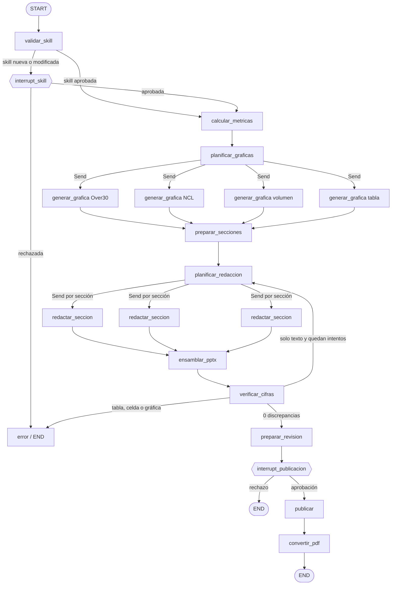

# 07 - Grafo LangGraph de presentaciones

## 1. Qué se construyó

| Archivo | Responsabilidad |
|---|---|
| `src/basecards/agentes/presentaciones/grafo.py` | Define `GraphState`, `RunContext`, los adaptadores de herramientas, los nodos del pipeline E6, las aristas condicionales, `Send`, `interrupt()` y la compilación del grafo. |
| `src/basecards/agentes/presentaciones/__init__.py` | Expone el constructor del agente de presentaciones. |
| `src/basecards/presentaciones/marcadores.py` | Define el parseo y renderizado de `{{m.*}}`, además de la detección de cifras literales fuera de marcadores. |
| `src/basecards/presentaciones/nodos/redactar.py` | Ejecuta la redacción con el LLM local, envía `num_ctx` explícito y aplica el límite de dos intentos. |
| `src/basecards/presentaciones/grafo.py` | Reexporta el grafo nuevo para conservar el import histórico `basecards.presentaciones.grafo`. |
| `src/basecards/presentaciones/estado.py` | Reexporta `GraphState` y `RunContext` para consumidores antiguos. |
| `tests/presentaciones/test_marcadores.py` | Prueba formatos, parseo, sustitución y cifras literales. |
| `tests/presentaciones/test_redactar.py` | Prueba un LLM falso, `num_ctx`, reintento y `E-RED-002`. |
| `tests/agentes/presentaciones/test_grafo.py` | Prueba el flujo con herramientas mockeadas, interrupciones, `Send`, verificación y publicación. |

Las dependencias de herramientas se inyectan mediante `PresentacionesDependencies`.
Esto mantiene las firmas existentes de `skill_validar`, `metricas_calcular`,
`pptx_ensamblar`, `documento_verificar_cifras` y `documento_convertir`, y permite
usar `InMemorySaver` y mocks en las pruebas.

El grafo usa un `TypedDict` serializable. Las rutas se guardan como texto y los
resultados de verificación se convierten a diccionarios. La identidad no forma
parte de ese estado: `user_id`, `roles` y `area` viven en
`config["configurable"]` y se leen con `obtener_run_contexto`.

## 2. Flujo paso a paso



### Entrada y validación

La capa llamadora proporciona la skill, cohorte, rango MOB, fuente de datos,
rutas del borrador y rutas de salida. `validar_skill` ejecuta el validador
existente. Si la skill viene de un borrador o su baseline/hash difiere, el
flujo se detiene en `interrupt_skill` antes de calcular métricas.

La respuesta de la aprobación de skill se reanuda con el mismo `thread_id` y
`Command(resume=...)`. El nodo registra una auditoría en el estado, pero no
promueve archivos, no escribe base de datos y no modifica Git.

### Cálculo y gráficas

`calcular_metricas` llama a `metricas_calcular`, que traduce el DSL cerrado a
SQL DuckDB. El LLM nunca calcula métricas. `planificar_graficas` devuelve
instancias `Send`; cada worker determinista invoca `graficas_generar` con un
identificador de gráfica. `graficas` usa un reducer basado en `operator.add`
para unir los resultados del fan-out.

### Redacción y ensamblaje

`preparar_secciones` lee `SKILL.md` y produce un objetivo por diapositiva.
`planificar_redaccion` envía una sección por instancia de `redactar_seccion`.
Cada instancia recibe únicamente su objetivo y el resumen de métricas.

El nodo usa el LLM inyectado. Para `ChatOllama`, cada llamada envía:

```python
llm.invoke(mensajes, options={"num_ctx": llm_num_ctx})
```

El texto se rechaza si contiene una cifra de negocio fuera de un marcador. Se
permite escribir `MOB 12`, periodos, fechas y categorías fijas como `30+`. La
segunda respuesta inválida produce `E-RED-002`.

`ensamblar_pptx` convierte las respuestas textuales a la estructura que ya
exige `pptx_ensamblar`. El ensamblador sustituye los marcadores y genera el
`.pptx`; no calcula ni interpreta cifras.

### Verificación y entrega

`verificar_cifras` llama a `documento_verificar_cifras` antes de cualquier
publicación. Una discrepancia de texto puede volver a las secciones afectadas
hasta el límite definido. Una discrepancia de tabla, celda o gráfica termina
en error porque exige corregir los datos deterministas.

Con cero discrepancias, `preparar_revision` puede generar miniaturas mediante
el `SandboxRunner`. Después `interrupt_publicacion` solicita la aprobación del
analista. Ese nodo solo crea el payload y llama a `interrupt()`; no mueve
archivos ni toca una base de datos.

Si el analista rechaza, el borrador se conserva como evidencia y el flujo
termina sin publicar ni convertir. Si aprueba, `publicar` mueve el archivo y
`convertir_pdf` llama a `documento_convertir` con el runner del sandbox.

La reanudación de publicación tiene esta forma:

```python
resultado = grafo.invoke(
    Command(
        resume={
            "aprobado": True,
            "analista_id": "analista-1",
            "comentarios": None,
            "timestamp": "2026-11-27T12:00:00Z",
        }
    ),
    config=misma_configuracion_con_mismo_thread_id,
)
```

## 3. Decisiones y reglas del PRD aplicadas

### ADR-10

- `StateGraph` fija el orden del pipeline.
- `Send` paraleliza las gráficas y la redacción por sección.
- `interrupt_skill` y `interrupt_publicacion` son nodos aislados.
- Las acciones irreversibles (`publicar` y la promoción de una skill) ocurren
  después de la aprobación, nunca dentro de un interrupt.
- La identidad llega por `config["configurable"]`, no por argumentos generados
  por el LLM.

### RB-03: cero cálculo en el LLM

Las métricas se calculan con `metricas_calcular` y su DSL cerrado. La narrativa
recibe los resultados, pero el modelo no recibe permiso para modificar
fórmulas ni calcular ratios.

### RB-04: marcadores

La redacción acepta `{{m.<metrica>.<cohorte>.<MOBn>|<formato>}}`. El detector
rechaza porcentajes, montos, tasas y conteos escritos como cifras libres. La
sustitución y el formato pertenecen al código determinista.

### RB-06: verificación antes de publicar

El `.pptx` pasa por `documento_verificar_cifras` antes de la pausa de
publicación. El resultado debe tener `discrepancias == 0`. La clasificación
conserva el campo `origen` para diferenciar texto de tabla, celda y gráfica.

### S-09 y auditoría

Las skills nuevas o modificadas requieren el rol `lider_riesgo`. La publicación
requiere el rol `analista`. La respuesta humana se conserva con actor,
comentarios, timestamp y decisión.

### Sandbox

La conversión se delega a `documento_convertir` y a un `SandboxRunner`
inyectado. El grafo no ejecuta `soffice` ni `pdftoppm` directamente.

## 4. Cómo probarlo

Prueba de integración solicitada:

```powershell
.\.venv\Scripts\python.exe -m pytest tests/agentes/presentaciones/test_grafo.py -q
```

Pruebas unitarias del nuevo código:

```powershell
.\.venv\Scripts\python.exe -m pytest tests/presentaciones -q
```

Validación de estilo:

```powershell
.\.venv\Scripts\ruff.exe check src tests
.\.venv\Scripts\ruff.exe format --check src tests
```

Las pruebas de integración usan `InMemorySaver`, por lo que no requieren
Postgres ni una conexión a `libpq`. Las herramientas de métricas, gráficas,
ensamblaje, verificación y conversión son mocks. El LLM también es falso y
registra que cada llamada recibió `options={"num_ctx": ...}`.
